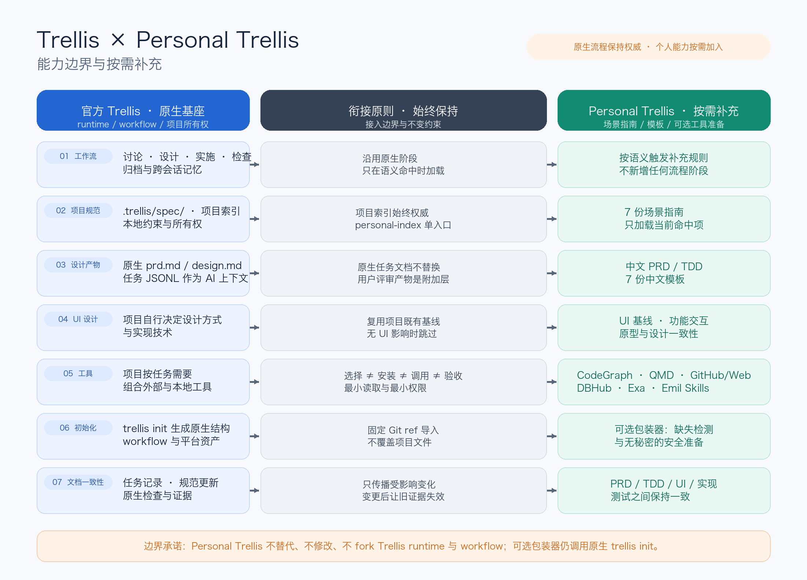
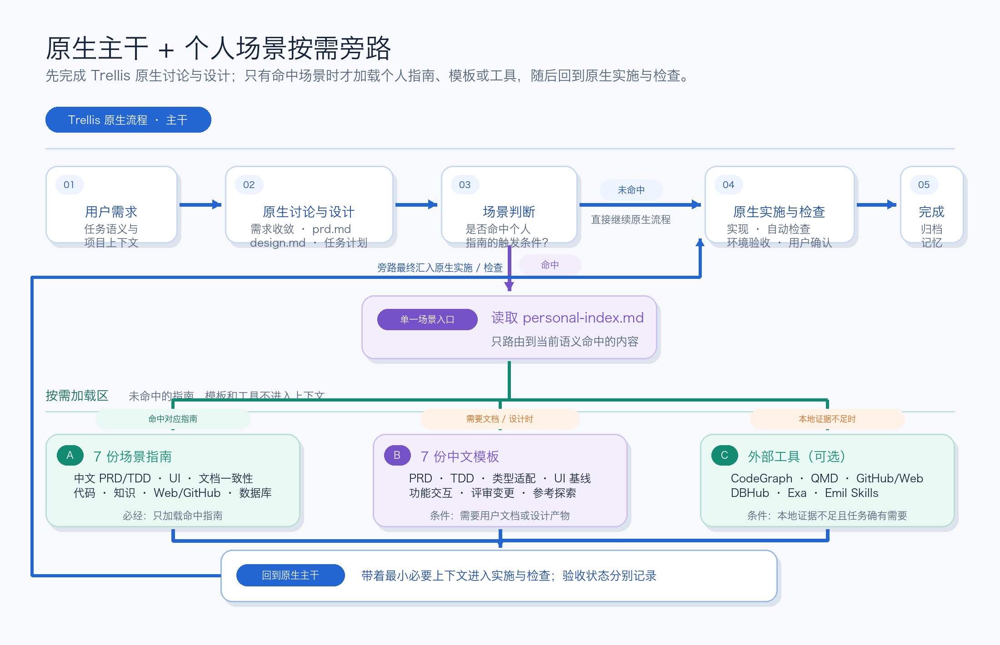

# Personal Trellis

把需求澄清、中文设计文档、UI 交付和测试验收中的个人实践，带进每一个
[Trellis](https://github.com/mindfold-ai/Trellis) 项目。

这是供使用 Trellis 的开发者与协作团队按需选用的**规范与模板库**：10 份场景指南、
9 份中文模板，以及可选的 Storybook 评审门户。原生 Trellis 继续管理任务流程、
项目规范和记忆；本库通过原生 registry 导入，在命中场景时补充指导。

**状态：1.4.4 公开候选，尚未正式发布，许可证待定。** 普通规范消费无需 clone，
也不需要 GitHub 登录；完整接入需要原生初始化、固定版本导入和一次项目入口挂载。

Personal Trellis 通过 Trellis 生成的平台集成资产支持**当前 Trellis 所支持的全部
Agent / 平台**，不限定于某两个客户端。实际可用平台、参数和生成文件以本机安装的
`trellis init --help` 及目标项目现有配置为准；未来 Trellis 版本可能增删或调整它们。

[快速开始](#快速开始) · [场景指南](#场景指南) · [中文模板](#中文模板) ·
[Storybook 预览](#可选-storybook-预览) · [更新与排障](#更新与排障)

## 能带来什么

- **需求讨论更深入**：从整体范围进入模块规则、字段、权限和异常，再复核跨模块流程。
- **评审产物可复用**：按项目规模生成中文产品需求说明、技术方案与 UI 设计，保留用户已有模板。
- **实现与验收可追溯**：需求、设计、实现、测试共用稳定引用；变更后更新受影响内容和证据。
- **工具按需进入**：先复用已有能力，确有缺口时再经确认准备工具，避免每个项目全量安装。
- **长期资产有入口**：需求版本、设计源与原型分别维护，可通过 Storybook 在同一入口评审。



Trellis 负责 workflow、任务生命周期、代理调度、项目索引和记忆；Personal Trellis
提供场景指南与中文模板。目标项目的既有规范保持权威，本库不 fork 或内置 runtime。

## 快速开始

### 交给 AI 完成接入

把下面这一段完整交给当前项目中的 AI；它会先识别现状，只在确有缺口时执行接入：

```text
请在当前项目中完成 Personal Trellis 接入。先检查 trellis 命令是否存在以及项目是否已有完整的原生 Trellis 结构。CLI 缺失时先查阅 Trellis 官方安装说明，列明准确版本、安装命令及本地/全局作用域，取得同意后安装并验证；不要静默全局安装，也不要对不存在的命令运行 --help。CLI 已可用后运行 trellis init --help，并检查现有平台目录、设置和 Trellis 生成文件，识别项目实际使用且当前 CLI 支持的 Agent / 平台。只使用帮助中与这些平台精确对应的 flags，多个平台可组合；不要凭印象编造参数或路径。优先从现有 Trellis 配置、项目资料和 Git 身份解析开发者身份。若尚未初始化，使用这些平台 flags 和已解析身份执行原生 trellis init；只有平台、身份或 registry 访问问题确实无法可靠判断且会影响执行时，才向我询问必要信息。若个人规范已导入，核对配置与文件；相同版本跳过导入，版本变化按本文“固定版本与更新”处理，不重复 init 来升级。首次导入前检查同路径冲突，发现冲突先停止导入并审阅合并方案；无冲突时用相同平台 flags，通过原生 registry 从 gh:zyf3313/personal-trellis#5002f63256660f94f273a111b832142c3d0f5b6d 导入 personal-core，并使用 --append。仓库是公开的，普通 registry 消费不要 git clone，也不要要求 GitHub 登录或 SSH key。保留现有 workflow、hooks、索引、本地规范、平台集成文件和其他项目文件；不要覆盖同名本地规范。检查该平台实际读取的项目指令、Skill、workflow、prompt、hook 或设置入口，并把扩展路由放在适用的用户自维护区、Trellis 管理或生成块之外；只追加或幂等更新这一个路由块，不重写其他内容。Codex 的 AGENTS.md、Claude Code 的 CLAUDE.md 只是示例，不要把它们当成所有平台的固定入口。要求 AI 在原生 Trellis 工作流处理请求前读取 .trellis/spec/trellis-extensions.md，并且只加载与当前请求匹配的指南，不新增阶段。不要静默安装第三方工具、登录账号、下载模型、暴露 token/密钥，或扩大权限；这些动作如确有必要，另行说明具体影响并取得授权。完成后检查真实文件与配置：扩展入口、10 份指南、9 份模板、registry 的精确 SHA 与 personal-core、既有文件保留情况、所选平台 flags、实际路由入口和一次真实场景读取；不要把退出码 0 单独当成成功。最后按 passed / failed / blocked 报告每项结果、证据和仍需我处理的事项。
```

### 1. 准备并初始化项目

先按 [Trellis 官方安装说明](https://docs.trytrellis.app/start/install-and-first-task)
准备 CLI 及其运行环境，并确认当前网络可以访问公开仓库
`zyf3313/personal-trellis`。无需 GitHub 登录、SSH key 或私有仓库权限。
示例中的 `/path/to/project` 和 `YOUR_NAME` 分别替换为已有项目目录与开发者身份；
不要在命令或项目文件中放入 token。

在项目目录运行以下**一个**原生初始化命令；已有完整 Trellis 项目可跳到第 2 步：

```sh
cd /path/to/project
# 将占位符替换成下表中与实际平台匹配的一个或多个 flags
trellis init -y <PLATFORM_FLAGS> --user YOUR_NAME

# 示例：Codex
trellis init -y --codex --user YOUR_NAME
# 示例：Claude Code
trellis init -y --claude --user YOUR_NAME
# 示例：Cursor 与 Pi Agent 同时使用
trellis init -y --cursor --pi --user YOUR_NAME
```

当前 CLI 0.6.9 的平台参数如下。多个 flags 可以组合；`--windsurf` 是映射到
Devin 的废弃别名，应优先使用 `--devin`。

| 平台 | flag | 平台 | flag |
|---|---|---|---|
| Cursor | `--cursor` | Claude Code | `--claude` |
| OpenCode | `--opencode` | Codex | `--codex` |
| Kilo CLI | `--kilo` | Kiro Code | `--kiro` |
| Gemini CLI | `--gemini` | Antigravity | `--antigravity` |
| Devin | `--devin` | Qoder | `--qoder` |
| CodeBuddy | `--codebuddy` | GitHub Copilot | `--copilot` |
| Factory Droid | `--droid` | Pi Agent | `--pi` |
| Reasonix | `--reasonix` | ZCode | `--zcode` |
| Oh My Pi | `--omp` | Trae IDE | `--trae` |
| Grok Build | `--grok` | Kimi Code | `--kimi` |
| Snow CLI | `--snow` |  |  |

Claude Code 状态栏可按需增加 `--with-statusline`。其他 Trellis 版本先重新运行
`trellis init --help`，不要照抄这份 0.6.9 清单。先初始化原生基线，再追加
扩展：已测 CLI 0.6.9 在全新单仓项目直接使用远程 spec 模板时，会跳过原生
spec 模板生成，而本库不包含原生 backend/frontend 模板及 `guides/index.md`。

### 2. 导入固定版本的个人规范

首次导入前先备份并检查 20 个目标路径；存在同名本地规范时停止导入，先审阅冲突。
已有个人规范的项目使用“固定版本与更新”，不重复初始化。
继续使用第 1 步实际选择的同一组 `<PLATFORM_FLAGS>`。`-y` 接受默认选项；
需交互时可移除。

```sh
trellis init -y <PLATFORM_FLAGS> \
  --registry 'gh:zyf3313/personal-trellis#5002f63256660f94f273a111b832142c3d0f5b6d' \
  --template personal-core \
  --append
```

例如 Codex 使用 `--codex`，Claude Code 使用 `--claude`，多平台项目可组合
`--codex --claude`、`--cursor --pi` 或帮助中其他实际适用的 flags。

导入成功后，`.trellis/spec/` 应包含 `trellis-extensions.md`、10 份指南、
9 份模板，共 20 份文件；`.trellis/config.yaml` 应记录上述 SHA 和
`personal-core`。**不要只看退出码**：已测 CLI 下载失败时可能退回空白模板并退出 0。

`--append` 只加入缺失文件，不合并同名内容，也不安装工具或挂载路由。
原生 registry 配置和 `.template-hashes.json` 会更新；项目 workflow、hooks、
索引与本地规范应保留。

### 3. 一次挂载，按场景读取

项目入口随平台而异。请项目中的 AI 检查第 1 步生成或复用的平台目录、设置、
Skill、workflow、prompt 与 hooks，找出该平台在主会话中实际读取的项目级入口；
以项目真实文件为准，不推测不存在的统一路径。Codex 常见入口是 `AGENTS.md`，
Claude Code 常见入口是 `CLAUDE.md`，它们只是示例，其他平台可能通过 Skill、
workflow、prompt、扩展或设置接入。

在确认适用的入口后保留全部现有内容，把下面路由加入**用户自维护区**；多平台项目
分别挂到每个实际入口，已存在则跳过。若入口文件同时含 Trellis 管理/生成块，
把路由放在块外并保留生成内容；若实际入口没有可维护区域，报告这一限制，不另造路径。

```md
## Project extension routing (user maintained)

Before handling a request in the native Trellis workflow, read
`.trellis/spec/trellis-extensions.md` and load only guides matching the user's request.
Apply clarification during native discussion and testing guidance only for requested
testing activities. Preserve native phases and project instructions; do not load
every guide or create extra phases.
```

文件导入不等于自动激活。项目索引中的链接只提供导航，`implement.jsonl` /
`check.jsonl` 只覆盖相应阶段；讨论阶段需要上述实际可读的项目入口。
项目指令通常在会话启动时加载：写入或更新路由后，必须启动一个**真正的新会话**，
或使用目标客户端明确提供的 reload 机制，再做激活验收。修改路由前已经存在的
当前会话不能证明自动激活。这个生命周期结论已在 Codex 项目会话中验证；其他平台
应按自身的指令加载与 reload 机制验收，不能直接假定与 Codex 完全相同。

随后用真实请求检查 AI 是否读取 [扩展入口](spec/trellis-extensions.md)
及匹配指南。轻量黑盒标准如下：

下表是持续适用的验收标准；截至 2026-10-18，三类普通请求已有对应的真实新会话
证据，范围和限制见“已验证范围”及任务研究报告。静态文件、链接、哈希、退出码 0
和合成匹配仍不能替代模型会话证据。

| 新会话请求 | 成功标准 |
|---|---|
| 大型、多模块需求 | 实际读取扩展入口与 `spec/guides/module-clarification.md`，进入“整体范围 → 逐模块细化 → 跨模块复核”；不顺带加载产品设计、UI、测试或工具指南 |
| 测试分析、用例或验收 | 实际读取扩展入口与 `spec/guides/testing-acceptance.md`；不因存在其他指南而全量加载 |
| 小型文案或单点修改 | 不加载全部扩展指南；直接处理已知小范围，只有真实语义命中时才追加匹配指南 |

验收报告必须列出模型实际读取的项目路径、请求类型、命中指南、未加载的无关指南
以及是否发生文件修改或外部动作。文件存在、链接有效、进程退出 0、哈希一致或
合成字符串匹配只能作为静态前置检查，不能替代真正新模型会话的读取证据。



一个任务可命中多个场景，但不默认加载全部指南。个人指导融入原生讨论、设计、
实施和检查；小修复只读取必要内容。

## 场景指南

| 你的任务 | 阅读指南 | 使用边界 |
|---|---|---|
| 大型、多模块需求或深入查缺 | [模块澄清](spec/guides/module-clarification.md) | 整体范围 → 逐模块细化 → 跨模块复核；小任务只补关键缺口 |
| 中文 PRD/TDD 与重大方案评审 | [产品与技术设计](spec/guides/product-technical-design.md) | 明确要求直接触发；大型任务收敛后询问一次，小修复默认不生成 |
| 界面、交互、设计稿或原型 | [UI 设计](spec/guides/ui-design.md) | 先确认最低 UI 基线；已有项目复用设计系统，无 UI 影响则跳过 |
| 需求、设计、实现或证据变化 | [文档一致性](spec/guides/document-consistency.md) | 更新受影响权威源与投影，失效证据重新验证 |
| 复杂规则或非显然实现决策 | [代码注释](spec/guides/code-comments.md) | 解释原因、约束和副作用，不逐行翻译代码 |
| 定义、签名、调用和影响范围 | [代码检索](spec/guides/code-search.md) | 结构查询优先；已知小文件和字面量直接读取或 `rg` |
| 跨文档发现与历史决定 | [知识检索](spec/guides/knowledge-search.md) | 按需检索，单个已知文档直接读取 |
| 当前事实、开源参考、GitHub 检索 | [Web 调研](spec/guides/web-research.md) | 优先一手证据，本地事实足够时跳过 |
| schema、数据或 SQL 检查 | [数据库访问](spec/guides/database-access.md) | 最小只读；连接与写入按具体范围授权 |
| 用例、自动化、执行、缺陷与回归 | [测试与验收](spec/guides/testing-acceptance.md) | 需求决定预期，代码提供分支证据；共用用例源、独立运行报告 |

详细触发条件、跳过条件、工具降级与验收要求，以各指南和
[扩展入口](spec/trellis-extensions.md) 为准。

## 中文模板

| 模板 | 用途 | 使用方式 |
|---|---|---|
| [产品需求说明](spec/templates/prd.zh-CN.md) | 背景与范围、业务流程，以及模块内的职责、功能、规则、字段、异常和验收 | 面向用户评审；不替代原生 `prd.md` |
| [技术方案](spec/templates/technical-design.zh-CN.md) | 总体方案、实体/存储、模块实现、专项设计、迁移、测试和配置 | 面向用户/研发评审；不替代原生 `design.md` |
| [技术方案类型适配](spec/templates/technical-design-profiles.zh-CN.md) | Web/API、前端/移动端、CLI/SDK、数据任务、基础设施等类型裁剪 | 与技术方案组合，按项目类型裁剪 |
| [UI 基线](spec/templates/ui-baseline.zh-CN.md) | 设计语言、tokens、组件、整体框架、导航和全局状态 | 0→1 或缺少基线的 UI 项目在实现前确认 |
| [功能交互设计](spec/templates/ui-feature.zh-CN.md) | 页面、模块、功能、状态、交互、异常恢复和原型 | 已有基线后按受影响模块设计 |
| [评审与变更记录](spec/templates/review-change.zh-CN.md) | 冻结版本、需求到验收映射、变更传播与证据失效 | 并入现有方案或任务记录 |
| [参考项目探索](spec/templates/exploration.zh-CN.md) | 候选项目、来源、复用点、限制与选型证据 | 重要参考项目探索时使用 |
| [测试用例](spec/templates/test-cases.zh-CN.md) | 需求依据、代码对照、数据、步骤检查点、优先级和自动化关联 | 用户已有模板优先；表格与详情为主，脑图按需且共用源文件 |
| [测试执行与验收](spec/templates/test-execution.zh-CN.md) | 每次运行的结果、缺陷、证据、回归与验收限制 | 与用例定义分离，引用用例和代码版本，可并入已有报告 |

模板随 `personal-core` 进入 `.trellis/spec/templates/`。只读取当前场景所需
文件；小任务不强制生成产品需求说明、技术方案或整套 UI 设计。

## 需求与长期资产

优先沿用项目现有目录；没有约定时可按需采用下列布局，不创建空文件：

```text
docs/requirements/YYYY-MM-DD-slug/
  README.md                 # 身份、状态、任务与权威源引用
  product-requirements.md
  technical-design.md
  test-cases.md
  test-runs/<run-id>.md
docs/requirements/archive/YYYY-MM/YYYY-MM-DD-slug/
design/ui/                  # 长期设计源、tokens、组件与页面
design/prototypes/          # 真实原型源码与状态
review/                     # 可选评审运行器
```

一项需求可关联多个原生任务，任务链接需求版本与负责模块，不复制正文。
需求归档时保留长期 UI/原型资产，并记录其不可变版本。产品需求说明、技术方案
是面向用户的附加产物，不替代原生 `prd.md` / `design.md`。
具体组织与归档规则见 [产品与技术设计](spec/guides/product-technical-design.md)。

## 可选 Storybook 预览

仓库已交付 [Storybook starter](starters/storybook/README.md)，可独立复制到项目，
在“文档 / UI 设计语言与资产 / 可交互原型”三个中文分组中评审内容。
普通 registry 只导入 `spec/`，不会下载、安装或运行 starter。

需要 **Node.js 24+、pnpm 10.12.1**。先选用未占用的临时目录，并确认项目中
尚无 `review/`；已有目录应先比较再合并。以下命令从独立轻量分支取出已经验证的
**1.4.1 Storybook 快照**，使用无需认证的 HTTPS；其 spec 与当前轻量 registry
分别固定，不保证同字节：

```sh
git clone --depth 1 --branch storybook/v1.4.1 --single-branch \
  https://github.com/zyf3313/personal-trellis.git /tmp/personal-trellis-starter
git -C /tmp/personal-trellis-starter rev-parse HEAD
# 输出必须为 a185310cbacf6b755007c6f28c14f9e4a4297007
cp -R /tmp/personal-trellis-starter/starters/storybook /path/to/project/review
cd /path/to/project/review
pnpm install --frozen-lockfile
pnpm verify
pnpm dev
```

默认打开 `http://localhost:6106/?path=/story/dossier-home--overview`。
骨架自带明确标注的示例项目；接入真实项目时配置 `review.config.json` 和
manifest，方法见 [starter 接入说明](starters/storybook/README.md#接入真实项目)。

正文读取权威源文件，manifest 保存来源、版本与路由，生成内容不可手改。
修改源后重新生成并检查哈希；可选文档可省略，必需源缺失或投影漂移应失败。
静态构建成功只证明预览可生成，浏览器、设备与用户验收另行完成。

当前交付源已让 `ui-design` 真正可选：manifest 不含该产物，或它标为可选且来源
缺失时，不生成“共享设计资产”和“UI 设计说明”，类型检查与静态构建也不引用它；
来源存在时保持原有两个入口。`product-prototype` 仍是 starter 固定必需产物。
上述固定快照已包含这项修复。

## 工具与来源

以下是指南已有的工具路线；按场景先发现并复用本地 CLI、MCP、Skill 或内建能力，
用户指定的适用工具优先。确有缺口时，说明官方来源、审阅版本、动作和影响，
经同意后由 AI 安装或配置，再验证客户端加载与最小真实任务。

| 工具 / 上游 | 用途 | 详细规则 |
|---|---|---|
| [CodeGraph](https://github.com/colbymchenry/codegraph) | 定义、调用关系与变更影响 | [代码检索](spec/guides/code-search.md) |
| [QMD](https://github.com/tobi/qmd) | 文档集合与历史知识检索；关键词路线已实测 2.8.3，模型与 MCP 未启用 | [知识检索](spec/guides/knowledge-search.md) |
| [GitHub CLI](https://cli.github.com/) | 仓库、代码、issues 与一手源码 | [Web 调研](spec/guides/web-research.md) |
| [Exa MCP](https://github.com/exa-labs/exa-mcp-server) | 已有 Web 搜索不足时补充检索 | [Web 调研](spec/guides/web-research.md) |
| [Emil Skills](https://github.com/emilkowalski/skills) | 核心 UI 设计与条件专项检查 | [UI 设计](spec/guides/ui-design.md) |
| [DBHub](https://github.com/bytebase/dbhub) | 经授权的 schema、数据与 SQL 访问 | [数据库访问](spec/guides/database-access.md) |
| [linux.do](https://linux.do/) | 候选发现，以及入围后的真实体验、故障与维护成本证据；技术事实仍核对上游 | [Web 调研](spec/guides/web-research.md) |

UI 路线以 `emil-design-eng` 为核心；边界数据、动效和触摸目标分别按需使用
`break-ui`、`review-animations`、`mobile-native`。已有设计基线与适用工具优先。
测试生成和评审不要求新工具；执行优先复用项目框架，没有默认第三方测试 Skill。

社区讨论同时服务于早期发现和入围后的选择核验。重要或体验敏感的选型会在候选
收敛后做一次有界复查，并区分个人经验、流行度与可验证功能；论坛共识不作为技术
事实证明，证照、版本和实现能力仍回到上游核对。

拒绝安装或环境不支持时使用已有能力与明确降级方案。登录、API key、模型下载、
数据库连接/写入和外部发布分别处理授权；安装成功不能替代真实可用性验证。

### 工具软安装的只读验收

工具验收的目标是验证“先发现本地等价能力，足够就使用，不足才提出建议”的行为，
不是借验收之名安装工具。应在真正的新会话或客户端 reload 后，分别给出有界的只读
任务，并记录实际读取的扩展入口、工具指南、使用能力、结果与缺口。

这是一组受提示约束的只读探针，不是普通业务请求下完整的软安装黑盒。若首条提示
明确禁止安装、配置、登录和真实连接，则“没有安装”只证明该探针遵守了限制，不能
证明所有普通请求都会自动跳过安装。2026-10-18 的普通知识检索会话另行覆盖了
“能力缺失后推荐 QMD 并询问安装授权”的正向分支；随后用户明确授权，已实际安装
`@tobilu/qmd@2.8.3` 并完成当前会话 CLI 与关键词检索的最小真实任务验证，模型下载
与 MCP 保持未启用。三类的证据边界不同：探针证明遵守限制，推荐分支证明会先征询
授权，真实安装证明默认关键词路线可用；仍未验证 MCP/常驻服务、向量检索质量与
跨项目集合。

| 场景 | 只读探针 | 通过条件 | 必须区分 |
|---|---|---|---|
| 代码检索 | 查一个定义、调用关系或受影响文件，并抽查预期源码覆盖 | 先使用现有结构索引或本地检索；证据足够时不安装 CodeGraph | `codegraph_status` / 工具存在，不等于当前仓库索引覆盖完整或内容新鲜 |
| 知识检索 | 找到一项历史决定及原始文档路径 | 本地文本检索、项目记忆或已有文档能力足够时不安装 QMD、不建集合、不下载模型 | CLI/集合存在，不等于检索质量、集合新鲜度或语义模型可用 |
| UI 设计 | 对一个现有页面或设计基线做小范围检查 | 已有适用 Skill/设计能力可完成时复用，不安装并列核心 Skill | Skill 文件存在，不等于当前客户端已加载或真实任务已采用 |
| Web / GitHub | 读取一个公开上游事实，并报告不可访问来源 | 现有 Web 或公共 API 足够时不安装 Exa、不登录 GitHub；只声明真正读到的外部内容 | 发现 Web 工具或 `gh` 可执行文件，不等于认证成功、私库权限或外部页面读取成功 |
| 数据库 | 先用本地 schema、迁移、fixture 或 SQL 回答一个结构问题 | 本地证据足够时不安装 DBHub、不猜凭据、不建立真实连接 | 数据库客户端/配置存在，不等于指定数据源连接、只读约束或查询成功 |

每项按以下顺序执行：

1. 发现当前 CLI、MCP、Skill、连接器、项目文件和内建能力，说明哪个最小能力足以
   回答本次只读问题。
2. 能力足够时直接使用并报告覆盖与限制；本次“没有安装、没有登录、没有下载模型、
   没有连接数据库”是成功条件的一部分。
3. 能力不足时停在建议阶段：给出筛选工具、来源、准确动作、写入位置、下载/账号/
   凭证影响及所需授权。工具验收本身不得执行安装、客户端配置、登录、模型下载、
   凭据使用或真实数据库连接。
4. 分开报告工具发现、客户端加载、真实内容读取、索引覆盖/新鲜度、认证、连接和
   写权限；其中一项通过不能替代另一项。

## 更新与排障

### 固定版本与更新

规范与可选骨架分别固定提交，避免消费会漂移的 `main`。当前 1.4.4 轻量候选已同步
公开仓库，入口统一为 `trellis-extensions.md` 并删除 `personal-index.md` 迁移壳，
因此 spec 从 21 份变为 20 份；其余内容与 1.4.3 逐字节一致。1.4.2/1.4.3 的记录
保留各自当时的 21 份计数，不回填；具体范围见“已验证范围”：

| 产物 | 固定提交 | 内容 |
|---|---|---|
| 1.4.4 轻量 registry 候选（当前） | `5002f63256660f94f273a111b832142c3d0f5b6d` | 仅 `index.json`、`library.json` 与 20 份 spec 文件；入口统一为 `trellis-extensions.md`，删除 `personal-index.md` 迁移壳；其余 spec 与 `index.json` 同 1.4.3 逐字节一致 |
| 1.4.3 轻量 registry 候选 | `6b379fe58fddf7198261e89b9e0bbe7249f8fc07` | 仅 `index.json`、`library.json` 与 21 份 spec 文件；spec 与 `index.json` 同 1.4.2 逐字节一致，只把 `library.json` 推进到 1.4.3 并标为 `visibility: public`；已验证匿名 HTTPS 可检出该 SHA，未重复 CLI 远程导入实测 |
| 1.4.2 轻量 registry 候选 | `17321b18eb5fa5e35cd0341ae863797cbcf21388` | 本地核对与当前交付同字节；仅 `index.json`、`library.json` 与 21 份 spec 文件；新增知识检索实测记录；通过 CLI 0.6.9 全新项目远程导入（48.530 秒，21/21 spec 逐字节一致） |
| 1.4.1 轻量 registry 候选 | `8fca7f1a23e28d8b5d2dc86b525c814ae3a3afeb` | 通过 CLI 0.6.9 / Codex 全新项目远程导入；仅 `index.json`、`library.json` 与 21 份 spec 文件 |
| Storybook 1.4.1 轻量快照 | `a185310cbacf6b755007c6f28c14f9e4a4297007` | `storybook/v1.4.1` 的无父提交，仅含 40 个 starter 文件；包含可选 `ui-design` 修复 |

当前轻量提交对应 `registry/v1.4.4`，消费仍使用完整 SHA。个人规范升级遵循下面步骤；
**重复 `init --append` 不是升级**，它跳过同名文件，还可能重建当前 spec 的哈希基线。

1. 完整备份项目文件、`.trellis/config.yaml` 和 `.trellis/.template-hashes.json`，
   保留本地修改；不要只依赖 `trellis update` 创建的 `.trellis/.backup-*`，当前
   CLI 的该备份不包含 `.trellis/spec/`。审阅新旧 SHA 的文件清单与内容差异，明确
   新增、修改、删除和改名，再在隔离副本验证。核对所用 CLI 与项目 runtime 版本，
   不自动升级 CLI 或允许降级。
2. 只修改配置中的 `registry.spec.source` 为已审阅的新完整 SHA，保持
   `registry.spec.template: personal-core` 及其他配置。
3. 先运行下列预览，确认 registry 拉取成功，并逐项审阅**整个**变更计划。
   `trellis update` 同时处理当前 CLI 携带的原生模板、平台集成和迁移，
   并非仅更新个人 spec；只有全部计划都在授权范围内才执行实际更新。

```sh
trellis update --help
trellis update --dry-run
# 审阅完整计划并在隔离副本验证后：
trellis update
# 无人值守验证可保留所有冲突原件，并为上游版本生成 .new：
trellis update --create-new
```

新增文件可加入；内容相同的文件跳过；有可靠哈希基线且未本地修改的文件可自动
刷新。本地修改选择 Skip 或 Create copy（`.new`）后人工合并，只有明确审阅后的
单文件才选择 Overwrite；不使用 `--force` 批量覆盖。`--create-new` 会让未修改
文件继续自动更新，同时为所有本地冲突写 `.new`，适合有界的非交互验证。

当前 CLI 不会自动删除 registry 已移除/改名的普通 spec，也不会在 dry-run 或实际
update 计划中列出这些 registry 清单差异；必须在修改 config 前比较新旧固定 SHA，
记录并人工清理受影响路径。自动更新和新增文件会写入新模板哈希；保留本地原件并
生成 `.new` 时，原件继续保留旧基线；上游已删除但本地保留的文件及其旧哈希也不会
自动消失。完成合并/清理后再核对 config、实际文件与哈希，不手工伪造基线。

若曾重复 init、哈希基线不可信、版本不匹配或预览包含未授权的原生变更，停止自动
更新：保留备份，取得精确新旧快照，按旧版/本地/新版差异逐文件审阅合并，不覆盖
本地内容，不手工伪造哈希。记录实际合并和保留项；回滚恢复备份中的文件、配置与
哈希基线。无论退出码如何，均检查实际内容、registry SHA、冲突保留项和路由。
Trellis runtime 升级另按 [官方升级说明](https://docs.trytrellis.app/changelog) 审阅。

从 1.3.x 迁移时，把项目入口、自维护路由块和任务 JSONL 中的 `personal-index.md`
改为 `trellis-extensions.md`。1.4.4 起不再分发 `personal-index.md` 迁移壳；当前
CLI 不会自动删除上游已移除的 spec，已装项目需按“固定版本与更新”比较新旧 SHA
后人工删除该文件。原生 `guides/index.md` 仍由项目/Trellis 管理。历史变化见
[CHANGELOG](CHANGELOG.md)。

### 常见问题

| 现象 | 处理方式 |
|---|---|
| 退出 0，但看不到指南 | 检查终端是否退回空白模板，核对 20 份 spec 和 config 中的 SHA/template |
| registry 拉取失败或超时 | 确认网络可访问 `github.com` 与 `raw.githubusercontent.com`，registry 使用 `gh:zyf3313/personal-trellis#<完整 SHA>`；无需 GitHub 登录或 SSH key，不要换成完整 main |
| 文件已导入，讨论却未读取 | 检查实际 Agent / 平台生成文件与设置，确认路由位于其真正读取的项目指令、Skill 或 workflow 用户自维护入口；路由写入后启动真正新会话或按客户端机制 reload，再核对实际读取路径。Codex 的 `AGENTS.md`、Claude Code 的 `CLAUDE.md` 只是示例，索引链接与后期 JSONL 不能保证讨论激活 |
| 再次 append 后旧内容没更新 | 停止重复 init；按上述更新步骤审阅基线与差异，保留本地修改 |
| 小任务生成了整套设计文档 | 回到匹配指南的触发边界；小修复默认复用现有设计，用户明确要求除外 |

轻量 registry 用于缩小检出载荷：已测 CLI 的单个 Git 步骤有 30 秒上限，
完整 main 曾因图片与骨架检出超时。本库没有修改 runtime 超时或保证弱网成功。

## 已验证范围

截至 **2026-10-18**，1.4.2 固定 registry 已在全新项目通过真实远程导入：
在隔离项目做 `--codex` 原生初始化后追加导入，CLI 0.6.9 耗时 48.530 秒，
21/21 spec 与交付源逐字节一致，registry SHA 和 template 正确。导入前 114 个
文件中只有 `.trellis/config.yaml` 与 `.trellis/.template-hashes.json` 两个
CLI 管理文件被更新，没有删除，没有使用本地镜像或 URL 重写。1.4.1 此前以同法
验证（29.124 秒，21/21 spec 一致，111 个受保护原生文件未变）；
两条结论分别对应各自的固定提交，不互相替代。

**2026-10-19** 发布的 1.4.3 固定 registry 只做元数据推进：`index.json` 与
21 份 spec 和 1.4.2 逐字节一致，差异只有 `library.json` 的版本号与
`visibility: public`。该提交已推送到 `registry/v1.4.3`，并验证匿名 HTTPS
`git fetch` 能按完整 SHA 检出 23 个文件；本轮未重复 CLI 全新项目远程导入实测，
因此其分发结论继承同内容的 1.4.2 证据，不视为独立复测通过。

**2026-10-19** 发布的 1.4.4 统一入口为 `trellis-extensions.md`，删除
`spec/personal-index.md` 迁移壳，spec 变为 20 份、快照共 22 个文件；其余内容与
1.4.3 逐字节一致。该提交已推送到 `registry/v1.4.4`，本轮实测通过：匿名 HTTPS
`git fetch` 按完整 SHA 检出 22 个文件、`spec/personal-index.md` 已不存在、
`spec/trellis-extensions.md` 存在，且快照内 `spec/` 无任何指向已删文件的引用、
相对 Markdown 链接零断链。CLI `gh:` registry 端到端导入在本机仍 blocked——
`raw.githubusercontent.com` 连接被重置，本机 GitHub SSH key 亦未授权，与仓库
权限无关，因此未在 1.4.4 上取得新的导入通过证据；分发结论继承同内容的 1.4.2
实测，不视为独立复测通过。

因入口文件是删除而非改名，当前 CLI 的 update 计划不会清理该文件：已装项目需按
“固定版本与更新”比较新旧 SHA 后人工移除 `personal-index.md`。
`trellis-extensions.md` 路径不变，现有项目路由与既有激活验收证据继续有效。

在 fstar 写入 Codex 项目路由后，又以五个**真正新建的 Codex 项目会话**完成黑盒
验收；本轮新增的三条普通请求证据记录在任务研究报告中：

- 大型五模块需求的 `AGENTS.md` 由 Codex 会话上下文注入作为项目入口；工具实际读取
  `.trellis/spec/trellis-extensions.md` 和 `.trellis/spec/guides/module-clarification.md`，
  没有加载产品设计、UI、测试或工具指南，并按整体范围进入逐模块澄清；没有修改文件
  或安装工具。
- 五类工具只读验收读取扩展入口和代码、知识、UI、Web、数据库五份匹配指南。
  首条提示明确禁止安装、配置、登录和真实连接；现有能力足以完成有界探针，因此
  没有安装 QMD、UI Skill、Exa 或 DBHub，没有 GitHub 登录、模型下载、凭据猜测或
  真实数据库连接。这只证明受约束探针的行为；普通知识检索会话另行验证了缺失
  QMD 时推荐固定版本并询问授权；安装后可用性随后由授权实测覆盖。验收同时暴露了边界：
  CodeGraph 状态不能单独证明 BPM Vue 源码覆盖/新鲜度；
  `gh` 未认证；linux.do 访问超时；本地 SQL 可读但没有
  真实数据库连接。
- 普通知识检索请求读取扩展入口与知识检索指南，在 PATH 中未发现 `qmd`，且当前发现
  未找到可用的跨项目语义集合；随后只读核验 QMD 官方 `v2.8.3` 资料，建议固定版本
  安装并询问授权。没有安装、配置 collection、下载模型；公网工具参数未携带私有内容。
  该结果证明“缺能力 → 推荐 → 询问”分支；安装后可用性由下一条的授权实测补充，
  仍不证明语义检索质量、MCP 可用性或长期版本推荐。
- 授权后的关键词检索实测：全局安装 `@tobilu/qmd@2.8.3`（约 205.1 MiB），在项目
  `.tmp/` 隔离目录对 fstar 的 `.trellis/spec` 建集合，85 份 Markdown（424,581 bytes）
  建索引 0.864 秒、索引目录约 1.56 MiB；`content_vectors` 与 `llm_cache` 均为 0，
  无 `.gguf`，没有下载模型，也没有启动 MCP 或改动 Codex 配置。中英文关键词均命中
  预期文件，`qmd get` 窗口与源文件一致；宽泛单词 `projection` 命中 56 份、目标排
  第 33，改用短语 `"manifest projection"` 后命中 3 份、目标排第 2。该结论仅覆盖
  关键字路线，向量模型、MCP 与跨项目集合未验证；细节见
  [知识检索](spec/guides/knowledge-search.md)。
- 测试请求读取扩展入口、测试与验收指南、中文用例模板和代码检索指南，生成 24 条
  BPM 审批人快照中文用例草案；没有修改产品代码，也没有执行测试。小型文案请求只
  读取文档一致性指南，修改根 README 一句并运行 `diff --check`，取证后由主线程
  精确还原该句变更；两者都没有全量加载无关指南。

工具会话的复盘还发现，UI 能力探针没有以一个明确页面目标启动完整的目标化
`context`，历史检索在找到足够的 PRD 原文后又多做了会话记忆检索。因此本轮只证明
能力发现和有界只读停止边界，不证明目标页面的完整 UI 评审，也不把这次历史检索
作为最小工作量范例。

这些结果只证明 **2026-10-18 的当前 fstar/Codex 环境与所列请求**通过，不保证
其他平台、未来客户端版本或不同项目自动得到相同行为。Pi 的主会话挂载与真实激活
仍 blocked / 后置，需在其可写且可信的真实环境按平台生命周期另行验收。线程 ID、
提示、实际读取路径和限制记录在任务研究证据中；README 不依赖不可见的线程 URL。

另以同一 1.4.1 SHA 安装到临时已有项目，再升级到从其文件树派生、未推送的本地
1.4.2 根提交。`--dry-run` 和 `--create-new` 验证了未修改文件自动更新、本地冲突
保留并生成 `.new`、新增文件加入、上游删除不自动清理、选定原生文件不变、哈希
基线和完整人工备份回滚。该实验通过隔离 Git 配置映射到本地仓库，不是新远程发布
或 runtime 升级证据；完整记录保留在本次交付任务证据中，不随 registry 分发。

以下表格保留 **1.4.0 旧快照** 的补充证据，不代表 1.4.1 已重复验证这些场景。
表内只记录已执行的
Codex / Claude Code 证据子集，并不把 Personal Trellis 的支持范围限制为这两个
平台；其他 Trellis 支持的平台仍通过其生成集成资产接入，需在各自真实环境验收：

| 范围 | 结果 |
|---|---|
| 真实远程导入（导入时仓库尚为私有）：CLI 0.6.9 / Codex | 21/21 spec 字节一致，71 个受保护原生文件未变，registry 配置正确 |
| 真实远程导入（导入时仓库尚为私有）：CLI 0.6.17 / Claude Code | 21/21 spec 字节一致，69 个受保护原生文件未变，registry 配置正确 |
| Codex 挂载后单轮路由 | 1.4.0 的大型需求、测试请求和小文案修改三个历史合成场景通过；2026-10-18 当前 fstar 已取得大型需求、五类受约束工具、知识检索、测试和小文案五类新会话证据，仍只覆盖报告列出的请求范围 |
| Claude Code 模型路由 | 服务返回 HTTP 503，未取得模型结果；导入通过不代表路由通过 |

`library.json` 的 `tested_trellis` 记录 0.6.9 基线；上表补充具体 0.6.17 远程导入
结果，不扩展其他能力的兼容承诺。工具安装后的可用性、真实数据库、模型、浏览器/设备、
多轮对话质量和用户最终验收分别记录，不能由静态文件或导入测试推断通过。

## 致谢

感谢 [Trellis](https://github.com/mindfold-ai/Trellis) 团队提供原生工作流与 registry
基础。本库的可选路线与示例也参考了 [CodeGraph](https://github.com/colbymchenry/codegraph)、
[QMD](https://github.com/tobi/qmd)、[GitHub CLI](https://cli.github.com/)、
[Exa MCP](https://github.com/exa-labs/exa-mcp-server)、
[Emil Skills](https://github.com/emilkowalski/skills)、[DBHub](https://github.com/bytebase/dbhub)
和 [Storybook](https://storybook.js.org/)，也感谢 [linux.do](https://linux.do/)
社区分享真实使用经验与讨论；各项目和社区内容由其上游或作者独立维护并适用各自条款。

## 许可与项目资料

本库当前为公开候选，**许可证尚未确定**；公开可访问不代表已取得开放再分发许可。
版本、可见性和许可状态见 [library.json](library.json)，原生模板入口见
[index.json](index.json)。各外部工具与 Skill 遵循各自上游条款。

[Trellis 官方仓库](https://github.com/mindfold-ai/Trellis) ·
[官方文档](https://docs.trytrellis.app/) ·
[快速入门](https://docs.trytrellis.app/start/install-and-first-task) ·
[本库扩展入口](spec/trellis-extensions.md) · [变更记录](CHANGELOG.md)
