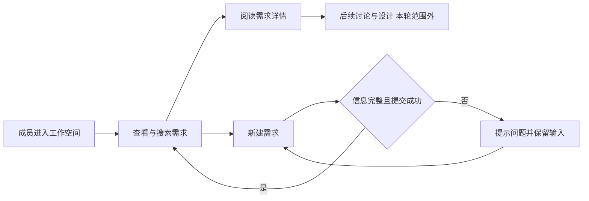
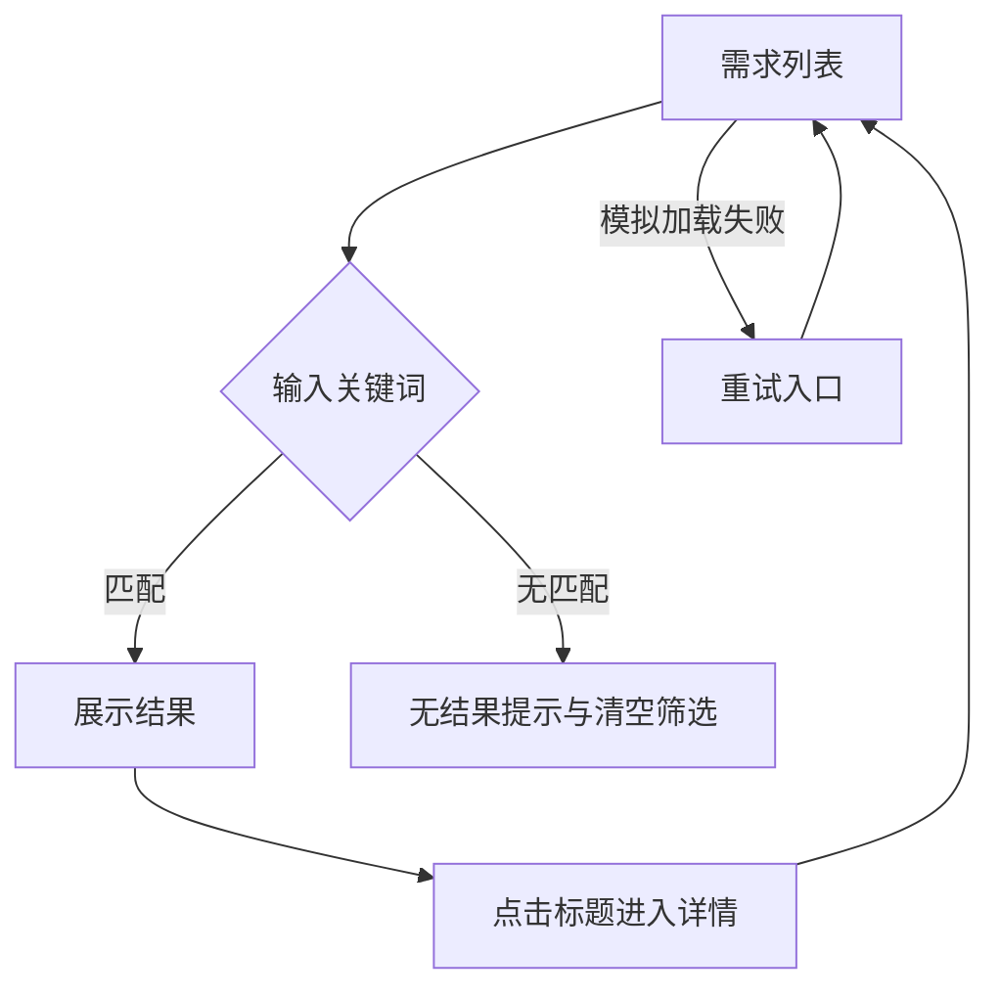
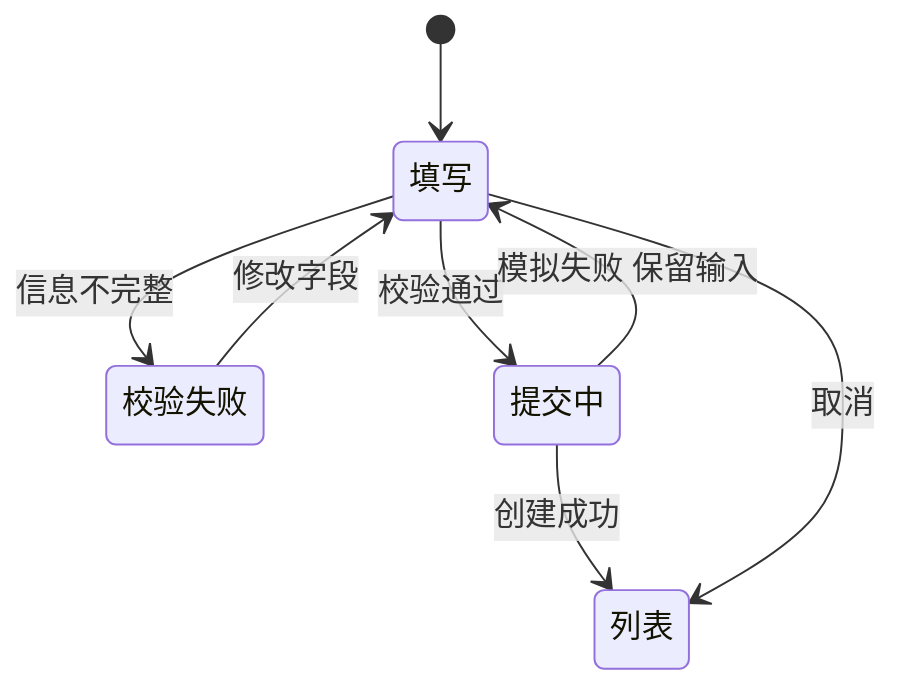

# 需求工作台 - 产品需求文档

> 状态：待评审示例 · 版本：v1.2 · 日期：2026-10-13 · 本文用于验收规范库交付方式，尚未代表用户确认的业务项目。

## 项目背景与目标

需求如果只保存在对话里，团队难以同时查看目标、模块归属和推进状态。需求工作台提供统一列表、详情及新建入口，让成员先记录业务问题，再进入讨论、设计与交付流程。本轮目标是验证 AI 能交付可编辑设计、逐状态画廊和真实交互参考。

## 业务全景与范围

本轮仅包含需求管理模块。登录、真实权限系统、多人协作、服务端持久化、编辑/删除及后续实施排期均不在样例范围。原型使用演示数据和浏览器存储；模拟权限拒绝不代表真实安全边界。

## 模块职责

| 模块 | 负责内容 | 输入与输出 | 与其他模块边界 |
|---|---|---|---|
| M01 需求管理 | 浏览、搜索、查看与登记需求 | 用户关键词/表单 → 需求列表/详情/提交反馈 | 后续评审与实施引用需求 ID，不由本轮代替其流程 |

## F01 浏览需求

普通演示成员可按标题或编号搜索需求、查看模块及状态，点击标题进入详情，再返回列表。搜索无结果时可清空筛选；加载失败保留筛选并允许重试；无权限给出明确反馈。

搜索不区分英文大小写，关键词匹配标题和编号。列表/详情展示用户文本时按文本处理，不能解释为 HTML。画板 B01–B05 分别表达正常、空、失败、拒绝、详情；这些是一个功能的状态。

搜索与计数归属同一个列表区域，搜索字段始终有可见标签。桌面以表格显示需求、模块和状态；760px 及以下以条目布局显示同一记录，标题、编号、说明、模块和状态可直接阅读。待讨论、设计中、待评审、实施中使用同源语义色，并始终保留状态文案；颜色不作为唯一识别依据。重置演示数据放在辅助操作区域。

## F02 新建需求

成员填写名称、所属模块、说明后创建需求。名称去除首尾空白后为 2–50 个字符；说明至少 5 个字符，输入上限 1000。校验错误靠近字段并聚焦首个错误；提交期间禁止重复提交。

成功后展示反馈，新记录位于列表顶部，状态为待讨论。取消不创建记录。提交失败保留输入，可取消失败演示后重试。画板 B06–B08 表达填写、校验、成功；实际原型补充提交中和失败恢复行为。

## 验收标准

| ID | Given | When | Then |
|---|---|---|---|
| AC01 | 初始三条记录 | 输入已有标题关键词 | 只显示匹配记录，计数一致 |
| AC02 | 搜索无匹配 | 清空筛选 | 返回完整列表 |
| AC03 | 列表可见 | 查看一条记录并返回 | 详情和列表记录一致，筛选保留 |
| AC04 | 模拟加载失败 | 点击重新加载 | 恢复列表，不丢关键词 |
| AC05 | 空表单 | 点击创建 | 显示字段错误，不新增记录，焦点在首个错误 |
| AC06 | 合法表单且模拟失败 | 提交再恢复重试 | 首次保留输入；重试仅新增一条并显示反馈 |
| AC07 | 表单输入完成 | 取消 | 返回列表，记录数量不变 |
| AC08 | 桌面或窄屏展示列表 | 阅读需求并进入详情 | 同一记录信息和状态一致；窄屏不用横向滚动才能阅读记录，搜索与恢复可操作 |

## UI 与交付引用

设计语言、组件合同及画板清单唯一源为 [design.json](../source/design.json)。技术机制见 [TDD](tdd.zh-CN.md)。画廊、原型、`.sketch` 均由构建入口生成；设计源改变后重新生成并验收。平台文件由用户手动导入，反馈与风格确认单列。本地工程预览骨架为 Storybook + Vue 3 + Vite，按功能和状态扩展。
