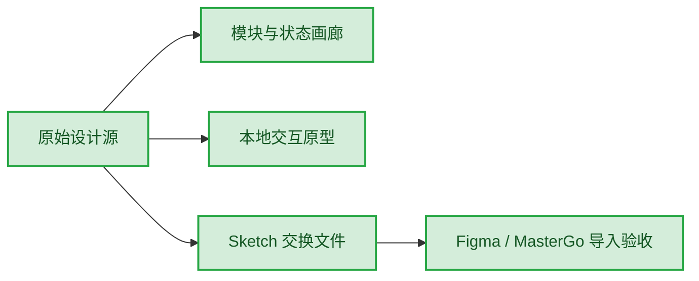
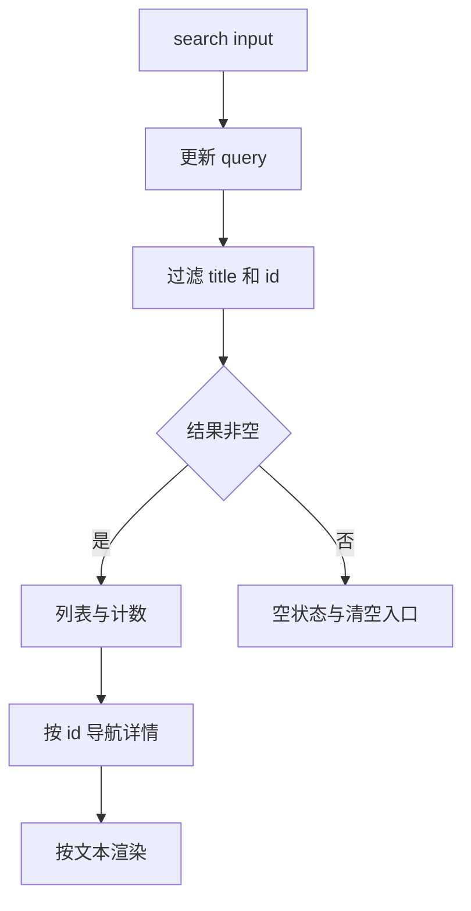
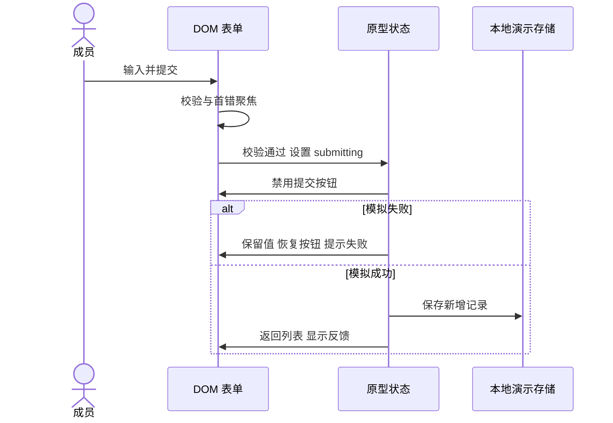

# 需求工作台 - 技术方案

> 状态：草稿 · 版本：v1.2 · 作者：Codex · 评审人：用户/待定 · 日期：2026-10-13

## 1. 需求理解与范围确认

背景是验证设计优先流程的可复用交付能力。目标是两功能、八状态画板、真实 DOM 原型及可编辑交换文件。新建样例无旧系统拆除；全景节点均为新增。

系统范围为本地设计生成器、静态交互参考，以及独立 Storybook + Vue 3 + Vite 预览工程，不涉及现有 fstar 业务。其他项目采用初始化时确认的实际栈与组件库。

## 2. 需求拆解

| 模块/功能 | 内容 | 角色 | 对应实现 |
|---|---|---|---|
| M01/F01 浏览需求 | 过滤、计数、详情与恢复 | 演示成员 | 原型列表/详情路由和列表渲染 |
| M01/F02 新建需求 | 字段校验、提交互斥、反馈与存储 | 演示成员 | 原型表单与提交状态 |

功能流程与条件见 [PRD](prd.zh-CN.md)。以下每功能有具体机制、异常和图示，不套用 REST 接口章节。

## 3. 实体与数据库设计

| 实体 | 核心属性 | 业务含义 |
|---|---|---|
| Requirement | id、title、module、status、description | 一项已登记的需求 |
| UIState | route、query、scenario、submitting、toast | 当前导航、筛选及交互状态 |

无数据库和 DDL。工程预览使用组件会话内的演示记录，切换 story 或重置时恢复种子；静态参考原型另有独立 localStorage 键，读取失败恢复种子，写失败保留当前会话并提示。这些均是演示机制，不用于真实敏感需求。

## 4. 需求功能详细设计

### F01 浏览需求

**入口/契约**：工程预览中由 list/detail 页面状态与选中记录驱动；静态参考采用 `#list` 和 `#detail/<id>`。关键词来源为搜索输入。过滤标题与 ID，不修改原记录。回列表保留关键词。

**异常机制**：模拟失败/拒绝只改变 scenario；重试恢复正常，保留 query。桌面表格和窄屏条目读取同一个过滤结果，CSS 断点决定可见表示，不创建第二份记录状态。状态样式来自设计源 `statusStyles` 和语义 token，列表、详情和交换画板保持对应关系；未知演示状态回退中性样式并保留文本。页面本身不得横向溢出。所有用户文本经 HTML 转义；长说明可换行。

### F02 新建需求

**入口/契约**：工程预览由 create 页面状态及 Vue 表单模型驱动；静态参考采用 `#create` 和 FormData。名称 trim 后长度 2–50；说明 trim 后至少 5。通过 aria-invalid、描述和焦点反馈错误。

**实现方案**：submitting 防止并发重复提交；350ms 延迟只模拟等待。离开表单后不提交旧实例。ID 用当前最大演示编号递增，适用于单浏览器示例，不能作为多用户全局 ID。成功清空筛选，插入顶部；取消不写数据。

## 5. 功能开发设计

`build.mjs` 从设计 JSON、生成器、锁文件和运行模板生成 scene、SVG、token CSS、画廊、原型和 Sketch。色彩/布局由单源 token/layout 决定；逐状态的可编辑 Rectangle/Text 与 SVG 同一个 scene。运行原型复用 token 和组件合同，行为代码独立审核；不是根据图片猜 DOM。

Sketch 使用公开 ZIP/JSON。旧 constructor 的中文流式序列化在当前 Node 上失败，改用标准 JSON 序列化；迁移为公开格式 146，并由 6.5.0 schema 验证。随机样式 ID 与 ZIP 时间固定化，重复生成应得到相同输出摘要。

## 6. 定时任务设计

不适用；没有后台定时任务。演示提交延迟不是业务定时任务。

## 7. 历史数据处理

不适用；不读取或迁移真实业务数据。重置入口只清理本示例存储键并恢复种子数据。

## 8. 测试与验收

业务 Given-When-Then 见 PRD AC01–AC08。文件验证覆盖 schema、画板/文本数量、可回读、同版复现、源改变导致旧 manifest 失效。浏览器验证覆盖列表/详情、输入校验、提交失败/恢复、空状态、权限/加载恢复、取消、窄屏及 console。

文件交付验证公开 schema、八画板、中文文本/矩形、回读和同版复现；Figma/MasterGo 由用户手动导入，提供入口和损失说明，不要求 AI 上传。用户导入反馈与视觉接受单列。

## 9. 影响范围

只新增个人规范库中的示例与生成产物，不修改 fstar 应用。原型使用独立存储键。平台导入文件不包含真实业务、凭证或私有代码。

## 10. 待确认项

| 问题 | 责任人 | 状态 | 结论 |
|---|---|---|---|
| 示例风格是否作为模板展示基线 | 用户 | 待确认 | 当前草稿，不替其他项目决定风格 |
| 用户手动导入后的反馈 | 用户 | 待反馈 | 文件与说明已提供，不阻塞本地交付 |

## 11. 配置项

无业务字典或角色配置。设计 token 位于 source/design.json；本地运行端口可选择，不写死进入业务规范。

## 12. 附录

参考：[PRD](prd.zh-CN.md)、[设计源](../source/design.json)、[使用与导入说明](../README.md)。

| 日期 | 版本 | 变更内容 | 状态 |
|---|---|---|---|
| 2026-10-13 | v1.1 | 两功能、同源画板/原型/交换文件与验证入口 | 草稿 |
| 2026-10-13 | v1.2 | 按 UI skills 评审收拢列表层次、同步状态语义色及窄屏条目，保留原交互范围 | 草稿 |
