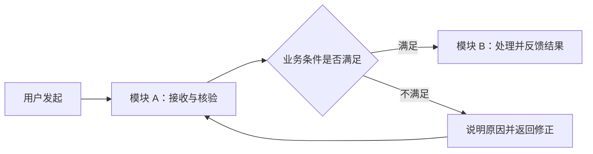
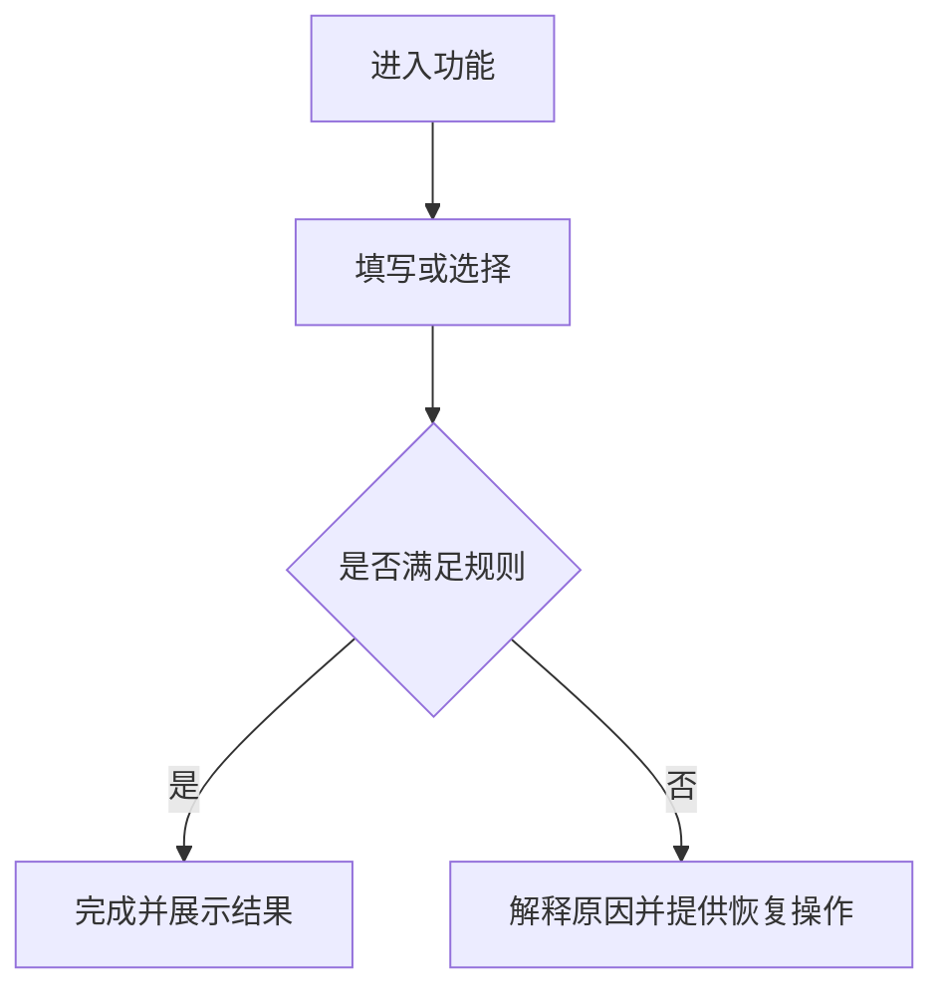

# [需求名称] - 产品需求说明

> **状态**：[草稿/评审中/已冻结] · **版本**：[v1.0] · **作者**：[姓名/账号] · **评审人**：[姓名/待定] · **日期**：[YYYY-MM-DD]

使用说明：按“背景与范围 → 业务流程 → 模块”阅读。模块内就近说明职责、
功能、规则、字段、异常和验收；术语、数据与字典引用放在第一次使用的位置。
删除不适用内容，不为满足模板编造独立目标、成功标准或技术实现。方括号和
示例必须替换为事实，未知项进入待确认表。

## 1. 背景与范围

- **业务背景与当前方式**：[谁在什么场景完成什么工作，当前如何流转]
- **本次要解决的问题**：[可观察的问题与影响]
- **本轮范围**：[涉及角色、业务对象、模块与结果]
- **本轮不做**：[排除项及原因]
- **依赖与约束**：[上下游、政策、时间、兼容或数据前提]
- **关联任务**：[一个或多个原生 Trellis 任务及负责模块；不复制任务正文]

| 需求编号 | 业务结果 | 涉及模块 | 优先级 | 对应验收 |
|---|---|---|---|---|
| R-001 | [用户完成后的可观察结果] | M-001 | [必须/后续] | AC-001 |

## 2. 业务流程

说明发起角色、结束条件、模块交接、状态变化与异常返回。新项目不编造旧流程；
改造项目区分现状与目标。

| 流程节点 | 责任角色/模块 | 输入 | 业务判断 | 输出/下一步 | 异常与恢复 |
|---|---|---|---|---|---|
| [节点] | [角色/M-001] | [对象] | [规则] | [结果] | [恢复方式] |

## 3. 模块

| 模块编号 | 模块名称 | 职责与边界 | 服务角色 | 输入/来源 | 输出/去向 |
|---|---|---|---|---|---|
| M-001 | [模块名称] | [负责和不负责什么] | [角色] | [输入] | [输出] |

### M-001 [模块名称]

#### 模块职责与协作

- **职责与业务对象**：[本模块解决什么问题]
- **角色、权限与数据范围**：[谁能看、谁能操作、资源归属]
- **上下游与交接**：[依赖、交接条件、失败归属]
- **适用术语/数据来源**：[术语定义、系统来源、同步或人工录入]

#### 功能

| 功能编号 | 功能名称 | 业务目的 | 入口/前置 | 结果 | 对应验收 |
|---|---|---|---|---|---|
| F-001 | [功能名称] | [用户价值] | [角色/状态] | [可观察结果] | AC-001 |

##### F-001 [功能/场景名称]

1. **正常流程**：[按用户操作和业务判断描述]
2. **业务规则**：[状态、权限、重复操作、数量、时效和跨模块约束]
3. **异常与恢复**：[取消、无权限、校验失败、依赖失败、重试和返回路径]
4. **界面与交互**：[页面/状态/原型引用；无 UI 时删除]

#### 字段与字典

字段应说明用户或系统实际看到的含义。字典字段引用稳定 `typeCode`，不在
产品需求说明中复制一套会与实现冲突的字典值；最终配置和值由技术方案维护。

| 字段 | 含义/来源 | 必填 | 长度/范围 | 格式 | 默认值 | 可编辑条件 | 校验/错误反馈 | 字典 typeCode |
|---|---|---|---|---|---|---|---|---|
| [字段] | [用户输入/系统/上游] | [是/否] | [限制] | [格式] | [默认] | [条件] | [规则与反馈] | [ORDER_STATUS](technical-design.zh-CN.md#dict-order-status) / 不适用 |

生成实际文档时把链接改为本需求技术方案的真实相对路径，同时保留锚点。

#### 模块验收

| 编号 | 关联需求/功能 | Given | When | Then（可观察结果） | 验收方式 |
|---|---|---|---|---|---|
| AC-001 | R-001 / F-001 | [前置状态] | [操作] | [结果与数据/状态变化] | [自动/浏览器/设备/人工] |

按“模块 → 功能 → 字段/规则 → 异常 → 验收”复制本节。业务数量、记录/事件
条数、初值与变化、状态守恒、回滚和重试语义需要在适用模块明确。

## 4. 跨模块要求与影响

- **权限与审计**：[跨模块身份、数据范围和留痕]
- **非功能要求**：[有依据的性能、容量、可用性、可访问性或平台限制]
- **兼容与迁移影响**：[旧流程、历史数据、客户端和上线条件]
- **UI/原型资产**：[长期资产路径、版本或不可变提交；原型不等同线上系统]
- **测试与证据**：[权威用例、运行报告和待真实验收项]

## 5. 待确认、评审与版本

| # | 问题 | 影响模块/决定 | 责任人 | 状态 | 结论 |
|---|---|---|---|---|---|
| 1 | [待确认问题] | [影响] | [账号] | 待确认 | - |

- **技术方案**：[真实路径与版本]
- **冻结记录**：[确认依据、版本和覆盖范围]
- **源与资产版本**：[Git ref、设计/原型版本]

| 日期 | 版本 | 变更内容 | 作者 | 状态 |
|---|---|---|---|---|
| [日期] | v1.0 | 初始版本 | [账号] | 草稿 |

区分文档完成、实现完成、自动检查、真实环境和用户验收。未执行项保留待验收。
