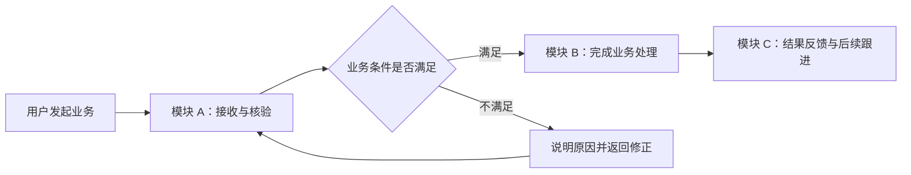
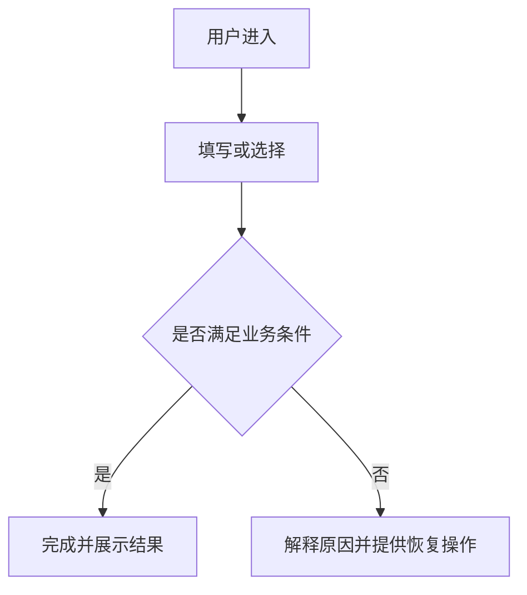

# [需求名称] - 产品需求文档

> **状态**：[草稿/评审中/已冻结] · **版本**：[v1.0] · **作者**：[姓名/账号] · **评审人**：[姓名/待定] · **日期**：[YYYY-MM-DD]

使用说明：本模板随 `personal-core` 导入到 `spec/templates/`。面向用户讲清项目背景、整体业务、模块职责、每项功能和业务流程，再说明如何验收。项目级 PRD 先给全景，功能级 PRD 引用已确定的全景并展开受影响模块。示例和方括号必须替换为本项目事实，未知项进入待确认表；不用开发任务列表替代业务需求。

## 1. 背景与目标

- **项目定位与阶段**：[这是一个什么项目，服务什么业务；从零建设/已有项目改造]
- **当前业务与工作方式**：[有哪些业务、参与方与系统，当前如何流转]
- **现状问题**：[用户目前如何完成工作，哪里造成成本或障碍]
- **目标用户与价值**：[为谁解决什么问题]
- **本轮目标**：[可观察或可衡量的结果]
- **成功依据**：[指标/用户任务完成条件，来源与评估方式]

## 2. 用户角色与使用场景

| 角色 | 目标 | 典型场景 | 可见内容/操作边界 |
|---|---|---|---|
| [角色] | [想完成什么] | [何时何地使用] | [权限、数据范围与限制] |

## 3. 范围与交付顺序

| 需求编号 | 本轮功能 | 用户价值 | 优先级 | 对应验收 |
|---|---|---|---|---|
| R-001 | [功能] | [价值] | [必须/后续] | AC-001 |

- **本轮不做**：[明确排除项及原因]
- **后续考虑**：[与本轮分开]
- **前置依赖**：[必要条件与真实状态]

## 4. 整体业务与端到端流程

- **业务全景**：[用业务语言描述各模块怎样协作完成主要目标]
- **流程发起与结束**：[谁在什么情况下发起，什么结果代表结束]
- **跨模块交接**：[交接的业务对象、责任变化及异常处理]

本图是待替换的结构示例，模块和角色必须来自真实业务。主要业务路径分别给图；新项目不编造旧流程。改造项目的现状/目标对照图在 TDD 中保持同一业务口径。

## 5. 模块划分与职责

| 模块编号 | 模块名称 | 负责的业务与对象 | 服务角色 | 输入/来源 | 输出/去向 | 责任边界与协作模块 |
|---|---|---|---|---|---|---|
| M-001 | [模块 A] | [负责什么业务，不负责什么] | [角色] | [业务输入] | [业务结果] | [边界/交接] |
| M-002 | [模块 B] | [负责什么业务，不负责什么] | [角色] | [业务输入] | [业务结果] | [边界/交接] |

职责按业务划分，不把“前端/后端/数据库”当成业务模块。外部系统、后续规划模块和本轮交付模块分别说明；每个本轮模块在下一章有对应内容。

## 6. 分模块业务与功能

### M-001 [模块名称]

- **业务说明与职责**：[本模块解决什么问题、处理什么对象]
- **用户与操作边界**：[角色、权限、数据范围]
- **协作与交接**：[依赖模块/系统，交接条件和结果]

| 功能编号 | 功能名称 | 业务目的 | 主要规则 | 业务图编号 | 对应验收 |
|---|---|---|---|---|---|
| F-001 | [功能名称] | [用户价值] | [核心业务规则] | D-M001-F001 | AC-001 |

#### F-001 [功能/场景名称]

- **关联需求**：[R-001 等；与范围表一致]

- **入口/前置条件**：[角色、当前状态]
- **正常流程**：[按用户操作描述]
- **结果**：[成功后用户看到什么、数据处于什么状态]
- **规则**：[必填、限制、权限、重复操作和业务约束]
- **异常/恢复**：[取消、失败、无权限、网络异常等适用情况]

**图编号**：D-M001-F001。图示表达业务动作、判断和结果，正文解释图中的规则。复杂业务状态另给状态图或状态表。每个功能关联图示；多个功能共用同一图时标出各自对应节点。

按“模块 → 功能”复制上述结构。用户应能从模块表定位职责，从功能表找到流程、规则与验收；只写一句“支持管理某对象”不足以描述功能。

## 7. 界面与交互（适用时）

- **全局 UI 基线**：[实际文件/版本]
- **应用框架与导航**：[实际文件/版本]
- **本功能交互与原型**：[实际文件/版本/可查看入口]
- **模块/功能画板索引**：[模块编号 → 功能编号 → 页面/状态/画板 ID]

| 页面/操作 | 正常状态 | 边界与异常状态 | 用户恢复路径 |
|---|---|---|---|
| [页面] | [行为] | [空/加载/权限/失败等] | [重试/返回/修正] |

没有用户界面时写明原因并裁剪。新项目先确认全局风格和框架，后续功能引用已冻结基线。

## 8. 非功能要求

只保留有业务依据的内容：数据/权限边界、兼容、可访问性、性能、容量、可靠性、语言或平台限制。指标必须给出适用场景与验证方式，不填写没有依据的数字。

## 9. 验收标准

| 编号 | 关联需求 | 场景 | Given（前置条件） | When（操作） | Then（可观察结果） | 验收方式 |
|---|---|---|---|---|---|---|
| AC-001 | R-001 | [正常] | [状态] | [动作] | [结果] | [自动/浏览器/设备/人工] |
| AC-002 | R-001 | [边界/异常] | [状态] | [动作] | [结果与恢复] | [方式] |

区分代码已实现、自动测试通过、真实环境可用和用户验收；未执行项保留待验收，不提前写通过。

## 10. 影响与待确认项

- **业务/模块影响**：[受影响模块、角色及协作流程]
- **依赖与上线条件**：[外部系统、数据、配置及其真实状态]

| # | 问题 | 来源/影响 | 责任人 | 目标日期 | 状态 | 结论 |
|---|---|---|---|---|---|---|
| 1 | [需要用户判断的产品问题] | [影响] | [账号] | [日期] | 待确认 | - |

仓库能回答的事实先查证；只向用户确认意图、范围、兼容或交互选择。所有阻塞本轮的决定收敛后才能冻结。

## 11. 关联文档、评审与变更历史

- **技术方案**：[真实文件与版本]
- **UI 基线/功能交互**：[真实文件与版本或不适用]
- **Trellis 任务**：[任务目录与需求编号映射]
- **冻结记录**：[实际确认依据与覆盖范围]

| 日期 | 版本 | 变更内容 | 作者 | 状态 |
|---|---|---|---|---|
| [日期] | v1.0 | 初始版本 | [账号] | 草稿 |
