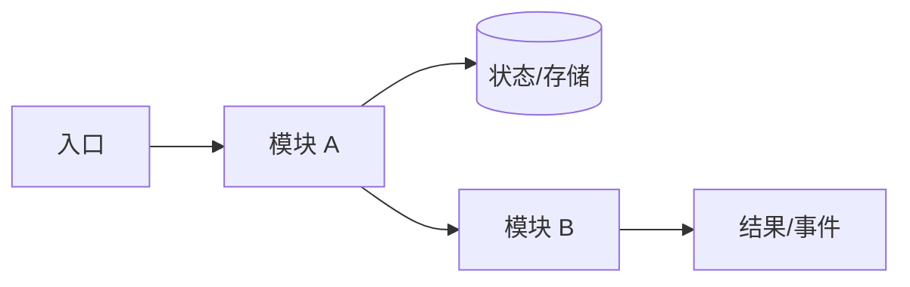
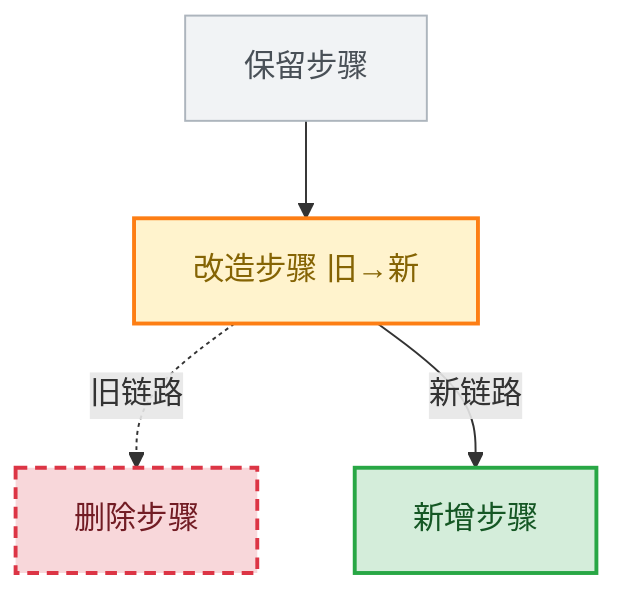
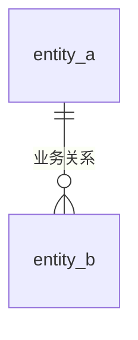
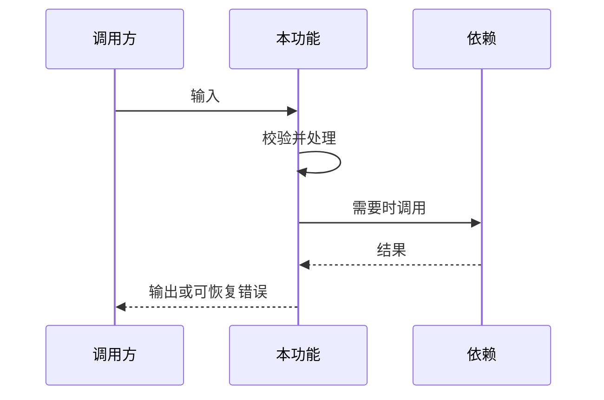

# [需求名称] - 技术方案

> **状态**：[草稿/评审中/已冻结] · **版本**：[v1.0] · **作者**：[姓名/账号] · **评审人**：[姓名/待定] · **日期**：[YYYY-MM-DD]

使用说明：按“理解与范围 → 总体技术方案 → 实体/存储 → 模块技术设计 →
专项技术设计 → 迁移/测试/影响/待确认/配置/附录”阅读。先讲每个模块和
功能怎样实现，再展开接口、CLI、批处理、库、异步、基础设施等专项合同。
按 [项目类型适配](technical-design-profiles.zh-CN.md) 裁剪，不强制 REST、
Java、关系数据库或固定章节数量。

## 1. 理解与范围

- **需求与验收依据**：[产品需求说明路径、版本、R/AC 编号]
- **本轮技术范围**：[系统、模块、客户端和实现边界]
- **本轮不做**：[排除项]
- **现状、依赖与约束**：[已核实技术事实、外部依赖、兼容要求]
- **UI 与原型依据**：[长期资产路径/版本；无 UI 时说明]

## 2. 总体技术方案与全景流程

- **方案摘要与选择原因**：[核心机制及为何适合]
- **组件与职责**：[所有者、依赖和调用方向]
- **数据/状态所有权**：[权威写入方、读取方、同步和一致性]
- **安全、事务、并发与观测边界**：[按实际风险]



改造项目标出新增、删除、修改和保留节点，并用文字说明兼容路径；新项目不
编造旧链路。跨系统交互改用时序图，生命周期改用状态图。

改造项目可使用以下对照图：绿色实线为新增、红色虚线为删除、橙色实线为
修改（节点写“旧→新”）、灰色为保留；新路径用实线，已替代旧路径用虚线。
非改造项目删除本段。



## 3. 实体、状态与存储结构

无持久化时说明内存、文件、浏览器、平台或外部系统中的真实状态归属。

| 实体/状态 | 核心字段 | 所有者 | 生命周期 | 一致性/并发要求 |
|---|---|---|---|---|
| [名称] | [字段] | [模块] | [创建到终止] | [要求] |

### 关系与结构



### Schema、DDL 与索引（适用时）

给出可执行的真实 schema/DDL、索引、约束、容量依据和迁移顺序。示例不能
冒充迁移文件；已发布迁移不可改写。非 SQL 存储使用对应 schema 和验证方式。

## 4. 模块技术设计

### M-001 [模块名称]

- **职责与边界**：[对应产品模块，不承担什么]
- **入口与依赖**：[页面、命令、函数、事件、服务或平台入口]
- **输入、输出与状态**：[真实合同与所有权]
- **实现结构**：[组件、调用链、数据流和选择原因]

| 功能编号 | 功能 | 实现机制 | 关键依赖 | 状态变化 | 验收 |
|---|---|---|---|---|---|
| F-001 | [功能] | [机制] | [依赖] | [前→后] | AC-001 |

#### F-001 [功能名称]

1. **入口与职责分配**：[具体组件和责任]
2. **真实输入/输出/状态**：[类型、空值、来源和去向]
3. **校验与权限**：[基础、业务、资源归属]
4. **关键处理步骤**：[含事务、并发、幂等或异步边界]
5. **失败与恢复**：[取消、超时、重试、部分成功、补偿]
6. **兼容和消费者影响**：[旧数据、旧客户端、下游]
7. **测试**：[用例/AC 编号、观察结果和环境要求]



按模块复制。模块技术设计必须覆盖总体拆解的全部功能；共享图需标明各功能
对应节点，不能只用系统架构图替代具体实现。

## 5. 专项技术设计（按实际类型选择）

专项放在模块设计之后，用于集中展示跨功能或同类合同。

### 接口/API（适用时）

| 名称 | Method/Path 或调用合同 | 请求/响应 schema | 权限 | 错误/兼容 | 消费者 |
|---|---|---|---|---|---|
| [接口] | `[POST /path]` | [真实 schema 引用] | [规则] | [语义] | [调用方] |

#### [接口名称]【新增】

- **所属模块/功能**：[M-001 / F-001]
- **URL 或调用合同**：`[METHOD /path]`
- **调用方与权限**：[身份、角色、资源和数据范围]

**请求**：

```json
{
  "field": "真实字段示例"
}
```

说明类型、必填、空值、长度/范围、格式、默认、枚举/字典、兼容字段和
schema 引用。文件、事件、RPC 等接口改用其真实合同。

**响应**：

```json
{
  "result": "真实结果示例"
}
```

说明成功、业务失败、系统失败、部分成功、分页/游标等实际语义，不强制统一
响应包。

**校验与处理**：

1. 基础字段和 schema 校验。
2. 身份、权限、资源归属和数据范围校验。
3. 状态、幂等、并发与业务规则校验。
4. 核心处理、事务/异步边界和提交结果。
5. 事件、通知、日志或审计等后置处理及其失败语义。
6. 返回结果与可恢复错误。

- **错误与恢复**：[错误码/类型、调用方动作、重试或补偿]
- **兼容与消费者影响**：[旧客户端、旧字段、灰度/版本窗口]
- **测试与验收**：[TC/AC 编号及关键断言]

#### [接口名称]【改造】

- **所属模块/功能**：[M-001 / F-002]
- **原合同与新合同**：[具体 schema/字段/语义差异]
- **请求**：[给出完整新请求合同或稳定 schema 引用；列明类型、必填、空值、长度/范围、格式、默认、枚举/字典及字段兼容]
- **响应**：[给出完整新响应合同或稳定 schema 引用；列明成功、业务失败、系统失败、部分成功及分页/游标语义]
- **校验**：[基础字段、身份权限、资源归属、数据范围、状态、幂等、并发与业务规则]
- **核心处理**：[保留、增加、修改和删除的步骤；事务/异步边界、状态变化、事件/审计及后置失败语义]
- **错误与恢复**：[错误码/类型、调用方动作、重试、补偿和回滚限制]
- **兼容与消费者影响**：[旧客户端、旧数据、旧字段、双读/双写、版本化、灰度窗口、废弃计划及结束条件]
- **回归与验收**：[受影响消费者、TC/AC、关键断言和环境]

每个接口应位于所属模块功能下，或从该功能明确引用本专项小节。不能只保留
接口概览而省略请求/响应、校验、处理和兼容细节。

### CLI/SDK/库（适用时）

说明命令/签名、参数、返回值或退出码、版本兼容、资源生命周期和示例。

### 批处理/定时/异步（适用时）

说明触发、分片/检查点、幂等、重试、乱序/重复、补偿、告警和重放。

### UI/客户端/平台（适用时）

说明路由/页面/组件、状态模型、缓存、权限、焦点/键盘/触摸、响应式和原型
映射。真实原型保留版本与模拟边界，不声称自动等同线上系统。

### 基础设施/配置（适用时）

说明资源、部署顺序、健康检查、容量、秘密边界、回滚和运行观测。

## 6. 迁移、发布与回滚

- **历史数据与资产迁移**：[范围、脚本/步骤、校验、不可逆限制]
- **发布顺序与兼容窗口**：[服务、客户端、配置、开关]
- **回滚/补偿**：[触发条件、输入、数据恢复和限制]
- **运行观测**：[日志、指标、告警、审计和关联 ID]

## 7. 测试与验收

| AC/用例 | 测试层级 | 数据与前置 | 观察结果 | 环境/命令 | 证据状态 |
|---|---|---|---|---|---|
| AC-001 / TC-001 | [单元/集成/UI/人工] | [前置] | [结果] | [环境] | [待执行] |

覆盖正常、边界、权限、失败恢复、兼容、迁移和回归。区分产品预期与实现观察，
并核对数量、初值/变化、状态守恒、回滚和重试。静态构建不等于工具或真实环境验收。

## 8. 影响与待确认

- **受影响模块/消费者**：[范围]
- **性能、容量、安全和可访问性**：[有依据的要求]
- **旧证据失效范围**：[需要重跑或重新确认的内容]

| # | 问题 | 来源/影响 | 责任人 | 状态 | 结论 |
|---|---|---|---|---|---|
| 1 | [问题] | [影响] | [账号] | 待确认 | - |

## 9. 配置与字典（适用时）

只列实际维护的最终值和内容解释，不为模板强制增加类型、作用域、重启方式
或所有者列。敏感值不入文档。产品需求说明仅引用字典 `typeCode`；本节是实现配置权威，
修改不得静默覆盖已确认业务决定。

| 配置项 | 维护值/内容 | 说明 |
|---|---|---|
| `[key]` | `[value]` | [业务/技术含义与来源] |

### 字典定义

为每个被产品需求说明引用的字典提供稳定锚点。锚点一旦被引用应保持稳定；
重命名时修复所有链接。

<a id="dict-order-status"></a>
#### ORDER_STATUS

| code | name |
|---|---|
| `PENDING` | 待处理 |
| `COMPLETED` | 已完成 |

## 10. 附录、评审与版本

- **产品需求说明**：[路径、版本]
- **源代码/协议/迁移**：[真实入口]
- **UI/原型资产**：[路径、版本或不可变提交]
- **Trellis 任务映射**：[任务 → 需求版本/模块]
- **冻结记录**：[确认依据和范围]

| 日期 | 版本 | 变更内容 | 作者 | 状态 |
|---|---|---|---|---|
| [日期] | v1.0 | 初始版本 | [账号] | 草稿 |
