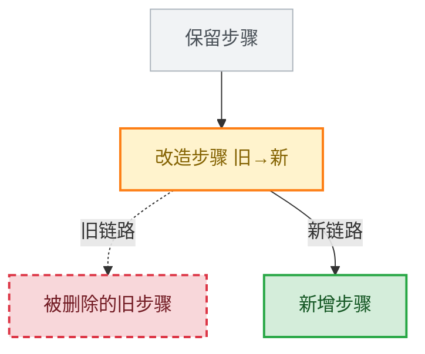
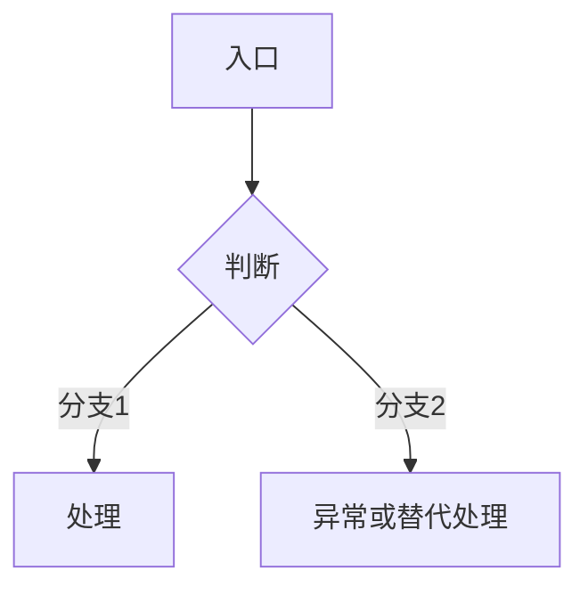
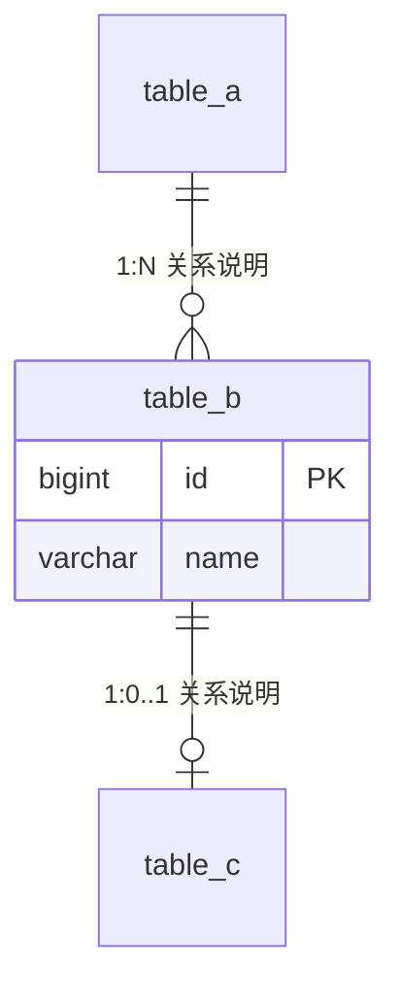
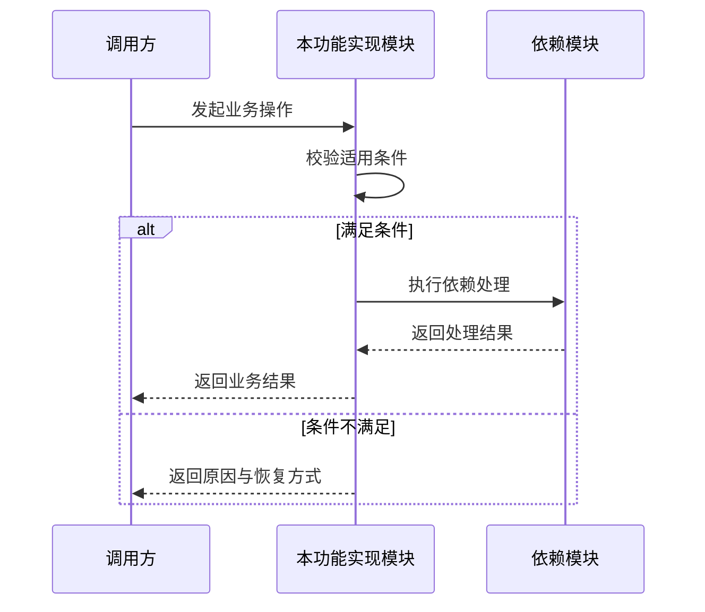

# [需求名称] - 技术方案

> **状态**：[草稿/评审中/已冻结] · **版本**：[v1.0] · **作者**：[姓名/账号/ldap] · **评审人**：[姓名/待定] · **日期**：[YYYY-MM-DD]

使用说明：TDD 在这里指技术设计文档（Technical Design Document）。十二章沿用用户给定骨架；每个业务模块、每个功能都要有具体实现方案及对应图示。按 [项目类型适配说明](../technical/technical-design-profiles.zh-CN.md) 选择契约、状态、数据与平台内容；不把所有功能改写成 REST 接口。方括号和示例必须替换为项目事实，未确定细节进入第 10 章；删除可选章节后统一编号或保留“不适用”说明。

## 1. 需求理解与范围确认

### 背景与目标

- **背景**：[为什么要做，现状问题是什么]
- **目标**：[要达成什么目标，关联 PRD 需求编号]
- **本轮不做**：[范围边界]

### 业务流程（改造对照全景图）

现状与目标合并为一张图，颜色、线型和文字共同标记改造点。新项目只展示新增和必要外部既有环节，说明没有旧链路。

| 样式 | 含义 |
|---|---|
| 绿色实线框 `add` | 新增节点 |
| 红色虚线框 `del` | 删除节点，保留原位置展示拆除点 |
| 橙色实线框 `mod` | 改造节点，节点内写“旧→新” |
| 灰色框 `keep` | 保留不变 |
| 实线边 `-->` | 新链路 |
| 虚线边 `-.->` | 被替代的旧链路 |



### 业务范围与架构边界

- **系统/模块范围**：[涉及的系统、模块、客户端]
- **技术栈与版本依据**：[来自实际配置或已确认选型]
- **模块职责与依赖**：[数据/业务/接口分别由谁拥有]
- **外部依赖与兼容边界**：[服务、平台、旧客户端及约束]
- **UI 依据**：[设计语言、整体布局与功能交互的文件/版本；无 UI 时说明]
- **项目类型与组合**：[Web/API、前端/移动/桌面、CLI/SDK、数据/异步、基础设施等；一个项目可按模块组合]

## 2. 需求拆解

### [功能模块 A 名称]

- **功能概述**：[一句话]
- **关联需求**：[PRD 编号]
- **用户角色**：[谁可以使用]
- **模块职责与边界**：[对应 PRD 模块编号、处理的业务对象、不承担的职责]
- **输入/输出与协作**：[跨模块调用、事件、文件或平台交互]

图型按内容选：流程用 `flowchart`，状态流转用 `stateDiagram-v2`，跨系统交互用 `sequenceDiagram`，实体关系用 `erDiagram`。不依赖未交付的外部图型指南。



**功能列表与实现定位**：

| 功能编号 | 功能内容 | 实现方案摘要 | 详细设计位置 | 图编号 | 验收编号 |
|---|---|---|---|---|---|
| F-001 | [业务动作与结果] | [采用什么机制完成] | [第 4/5/6 章实际小节] | D-M001-F001 | AC-001 |
| F-002 | [业务动作与结果] | [采用什么机制完成] | [实际小节] | D-M001-F002 | AC-002 |

每项功能至少关联一张有解释作用的图；可引用同一张综合图中的明确节点，不能只用一个系统架构图代替全部功能设计。图与功能编号、实际契约、状态及数据一致。

### [功能模块 B 名称]

按模块复制上述结构，并说明模块间协作契约；没有第二模块时删除。

## 3. 实体与数据库设计

有持久化时按真实数据库类型设计；无数据库时说明数据/状态的实际归属，裁剪表结构与 DDL。

### 概念模型

| 实体名称 | 核心属性 | 业务含义 | 数据归属 |
|---|---|---|---|
| [实体名] | [属性] | [说明] | [模块] |

### 实体关系（erDiagram）



适用关系型数据库时实体名用真实 `snake_case` 表名，关系说明写在引号内。关系图不代表跨模块可以越权查询或必须采用外键。

### 表结构设计

> **状态**：[待细化/已确定]

- **新增表**：`table_name_1`：[用途]
- **现有表改造**：`existing_table_1`：[改造点]
- **字段/索引/约束**：[必要结构、业务唯一性、容量与查询依据]

### DDL 与迁移

根据实际数据库给出可执行新增/改造 DDL、迁移顺序与验证；示例 SQL 不作为真实迁移。

```sql
-- MySQL 示例，替换为实际表、字段与注释后方可执行
ALTER TABLE existing_table_1
    ADD COLUMN new_column VARCHAR(64) COMMENT '[字段注释]';
```

说明历史兼容、并发/事务边界和回滚限制；已经发布的迁移不改写。无 SQL 数据库改用对应 schema/文档/索引设计。

## 4. 需求功能详细设计

### [功能模块 A 名称]

#### F-001 [功能名称]：实现方案

- **业务目标与关联需求**：[PRD 模块/功能/需求编号]
- **实现入口与职责分配**：[页面、命令、函数、事件或服务；具体实现由哪些组件承担]
- **输入、输出与状态**：[真实契约、状态归属及状态变化]
- **采用的方案**：[算法/组件/调用链/数据流/执行过程及选择原因]
- **关键步骤**：[逐步描述，包含必要的校验、核心处理、提交结果]
- **依赖与边界**：[其他模块、平台、外部资源、权限、并发或事务等适用条件]
- **异常与恢复**：[失败、取消、超时、重试、部分成功等实际语义]
- **兼容与影响**：[旧行为、数据、消费者或平台变化]
- **验证方式**：[验收编号、测试入口、需要观察的结果]

**图编号**：D-M001-F001。下例仅展示跨组件交互的画法；按内容替换为流程、状态、时序、数据流或结构图。



按功能复制本节，再附相应类型的详细契约。图示中的依赖不存在时删除，不为套图编造服务。新增方案评估必要的替代方案与取舍，内部小调整不机械增加大量选型比较。

#### 接口概览（接口类功能适用）

| 接口名称 | Method / Path 或调用契约 | 类型 | 说明 |
|---|---|---|---|
| [接口A-1] | `[POST /path]` | 新增 | [一句话] |
| [接口A-2] | `[GET /path]` | 改造 | [一句话] |

下面保留用户原模板的新增/改造接口格式。接口类功能使用；SDK、CLI、事件、桌面/系统交互替换为 [对应类型契约](../technical/technical-design-profiles.zh-CN.md)，不编造 REST 接口。第 4/5/6 章不能遗漏第 2 章列出的功能。

#### [接口名称 A-1]【新增】

- **接口 URL/调用契约**：`[METHOD /path]`
- **归属与消费者**：[模块/客户端/下游]

**入参**：

```json
{
  "field1": "字段说明",
  "field2": "字段说明"
}
```

**出参**：

```json
{
  "code": "响应码",
  "message": "响应信息",
  "data": {
    "field1": "字段说明"
  }
}
```

示例响应封装仅用于采用该合同的项目；替换为真实 schema，并补字段类型、必填性、空值、错误与必要示例。

**校验规则**：

- **权限/数据范围**：[身份、角色、资源归属要求]
- **基础校验**：[必填、长度、格式、范围]
- **业务校验**：[状态与一致性]

**核心逻辑**：

1. 参数校验。
2. 权限与资源范围校验。
3. 业务校验。
4. 核心处理：[事务、并发/幂等及失败处理，适用时补充]。
5. 后置处理：[日志/事件/通知与失败语义]。
6. 返回结果。

#### [接口名称 A-2]【改造】

- **接口 URL/调用契约**：`[METHOD /path]`
- **入参/出参变更**：[字段与 schema 变化]
- **改造点**：[列表]
- **兼容逻辑**：[旧客户端/旧数据/过渡期]
- **核心逻辑**：原有保留 [简述]；新增 [简述]。
- **错误与回归**：[受影响情况及验证]

## 5. 功能开发设计（可选）

仅非接口功能（导入导出、批处理、工具等）适用。

- **功能描述/关联需求**：[内容]
- **触发方式**：[操作/事件/命令]
- **输入/输出**：[合同]
- **核心逻辑**：[步骤]
- **异常处理**：[取消、失败、重试、部分成功与恢复]
- **权限/并发/幂等**：[按实际风险补充]

## 6. 定时任务设计（可选）

无定时任务删除。

- **功能描述**：[内容]
- **触发时间**：[频率、时区与错过触发的处理]
- **核心逻辑**：[步骤]
- **运行边界**：[幂等、重试、并发控制、告警与观测]

## 7. 历史数据处理

- **处理范围**：[数据范围；新项目说明没有历史数据]
- **处理方式**：[手动/脚本/自动]
- **执行时机**：[上线前/后与依赖]
- **核心逻辑**：[步骤]
- **校验与回滚**：[数量/一致性验证、备份、失败恢复和不可逆限制]

## 8. 测试与验收

### 验收标准（Given-When-Then）

| 编号 | 关联需求 | 场景 | Given | When | Then | 验收方式 |
|---|---|---|---|---|---|---|
| AC-001 | R-001 | [核心场景] | [前置状态] | [操作] | [结果] | [方式] |
| AC-002 | R-001 | [边界/异常] | [前置状态] | [操作] | [结果/恢复] | [方式] |

### 测试范围

- **单元测试**：[必要业务/回归用例]
- **集成测试**：[契约、接口、数据库与下游联调]
- **回归范围**：[受影响既有功能与客户端]
- **UI/真实环境**：[布局、交互、键盘/焦点、可访问性、浏览器/设备等适用门禁]
- **环境与证据**：[运行命令、依赖、数据集、时限、日志位置及跳过条件]

### 当前验证状态

| 范围 | 实现状态 | 自动检查 | 真实环境/用户验收 | 证据/限制 |
|---|---|---|---|---|
| [功能] | [状态] | [通过/失败/未执行] | [通过/待验收/跳过] | [真实记录] |

## 9. 影响范围

- **功能模块**：[模块与影响]
- **页面/客户端**：[页面与交互影响]
- **下游系统**：[系统与合同影响]
- **接口兼容性**：[是否需要客户端配合升级]
- **性能/容量/观测**：[有依据的指标、日志/告警与验证]
- **发布与回滚**：[配置、迁移、顺序、回滚输入及限制]

## 10. 待确认项

| # | 问题 | 来源 | 责任人 | 目标日期 | 状态 | 结论 |
|---|---|---|---|---|---|---|
| 1 | [问题] | [模块/资料] | [账号] | [日期] | 待确认 | - |

冻结前清除影响本轮范围、兼容、交互和验收的阻塞项；非阻塞延后项说明对当前方案的影响。

## 11. 配置项（可选）

无配置、字典/枚举或角色变化时删除。一般配置记录键、类型、默认值、作用范围、生效/重启方式和来源；敏感值不进入文档。

### [字典/枚举名称]

项目采用数据字典合同时，`dicCode` 使用大写字母与下划线，例如 `NATIVE_SYNC_PENDING`；新增字典同时给出 `dicTypeCode` 和 `dicTypeName`，改造已有字典可省略未变化信息。其他栈使用实际配置/枚举合同，不强制建立字典表。

- **dicTypeCode**：[新增必填]
- **dicTypeName**：[新增必填]
- **用途说明**：[内容]

| dicCode | dicName | 说明 |
|---|---|---|
| [UPPER_SNAKE_CASE] | [名称] | [说明] |

## 12. 附录

### 参考资料与权威来源

- [PRD 实际文件与版本]
- [UI 基线/交互实际文件与版本或不适用]
- [协议/数据/相关方案的实际入口]
- [技术栈规范来源与版本]
- [任务与需求/验收映射]

### 评审与变更历史

| 日期 | 版本 | 变更内容 | 作者 | 状态 |
|---|---|---|---|---|
| [日期] | v1.0 | 初始版本 | [账号] | 草稿 |

冻结记录包含确认依据和版本；实质变化先同步受影响 PRD、UI、任务与验收，再评审该部分。
